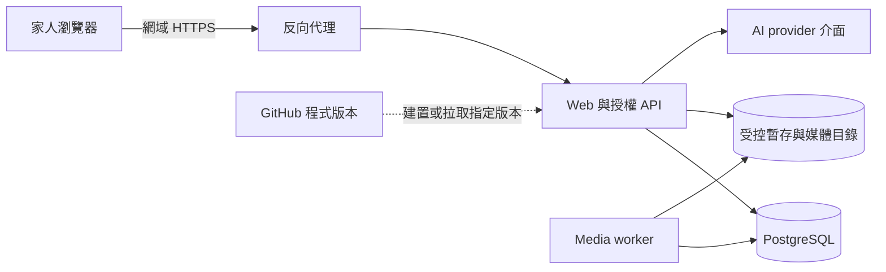

# 拾日家庭手札完整設計開發書

交接基準日期：2026-10-18。供使用者在 Antigravity 中交由 Claude 閱讀與實作。

本檔為產品需求、畫面規範、技術契約、部署、驗收與開工指令的單檔快照；目前是規劃與介面參考，尚無正式 app、資料庫或 NAS 部署。正式品牌暫用拾日。

需求優先順序：使用者最新指示 → AGENTS.md 與現行專題文件 → 本彙整快照 → 示意原始碼。實作後維護專題文件與交接，再執行 node scripts/build-design-handoff.mjs 重建本檔，不要雙份獨立修改。

圖片與介面原始片段隨完整資料夾附於 design-reference；單獨傳送本檔仍可閱讀全部文字設計，但不包含這些圖像資產。

## 章節索引

1. 開發規範
2. 產品與驗收規格
3. 畫面與互動設計
4. 系統與資料設計
5. NAS 部署與維運
6. 里程碑與驗收
7. 目前實作交接
8. Claude 開工指令

## 第 1 章 開發規範

來源文件：AGENTS.md。

本文件依使用者提供的開發原則整理，僅適用本專案。以使用者最新明確指示優先；不得以其他 AI 的風格偏好推翻既有工作。

### 理解與溝通

- 使用繁體中文台灣用語，說明直接、具體、可執行。程式識別字與技術名稱可用英文。
- 開始前確認 cwd、專案根目錄、Git 狀態；閱讀本檔、CLAUDE.md、README.md、docs、package.json、schema、環境範例與交接。尚不存在的檔案如實記錄。
- 先理解架構與資料流，不以單一檔案推論全系統；不猜測未查證的現況。發現風險或不合理需求要說明原因與替代方式。
- 區分使用者需求、設計建議、已完成、測試通過、尚未測試與部署狀態；不得以示意 UI 代替後端功能證據。

### 修改與依賴

- 優先沿用現有架構、最小必要變更、向下相容；保留未提交修改。不得為整理風格全面重寫。
- 不任意刪除功能、API、表、欄位、設定、環境變數或使用流程。
- 大型 UI、跨模組、資料庫、API、驗證、權限或重構前，先列出需求理解、現況、問題、方案、影響範圍、預計檔案、資料庫影響、風險與步驟。未決條件不影響的本機工作可持續進行。
- 基準技術為 Next.js、React、TypeScript、PostgreSQL、Prisma、專案 CSS、Lucide React。依實際已建立專案優先沿用；不得默默改成雲端代管或其他框架。
- 新增依賴先檢查現有能力，說明用途、必要性、授權與相容性；不為小功能加入大型套件，不任意升級主要版本。維護版本需在實作時查驗並固定 lockfile。

### 資料與安全

- 資料庫修改先讀 schema、關聯與資料影響；migration 保留資料，提供可行回復方案。不得在正式環境使用會遺失資料的操作，除非使用者明確要求。
- API 都須有輸入驗證、身份驗證、後端授權、清楚錯誤與狀態碼、必要稽核、交易、完整性及併發處理；不信任前端提供的作者、角色、時間或路徑。
- 密碼、API Key、Token、連線資訊由受控環境設定管理，不寫死、不提交 Git、不輸出到日誌。
- 防範 SQL Injection、XSS、CSRF、Path Traversal、惡意上傳、越權與 IDOR；UI 隱藏不是安全控制。
- 管理員不自動取得他人私人貼文權限；媒體、搜尋、留言、回憶、匯出及通知都須遵循貼文授權。
- 上傳限制類型、大小、配額與存放位置。NAS 原檔及資料庫不得因容器更新而遺失。

### Git 與協作

- 不執行 git reset --hard、git clean -fd、git push --force、任意改寫歷史或大量刪檔。
- Commit 訊息清楚，重大變更按功能拆分；未有明確目的地前不得推送遠端。
- 先理解其他 AI 的 TODO、Handoff、計畫、架構決策與註解；有實際問題才做必要修正。
- 專案規則放本檔，說明放 README，規格放 docs/specs，架構放 docs/architecture，交接放 docs/handoff；不將此專案規則寫成全域設定。

### 除錯與完成標準

- 先重現、取得完整錯誤、追蹤流程、找根因，再修正並回歸。尚未確認的根因要明列。
- 依修改執行 build、type check、lint、相關測試、API 及真實流程；無法執行時說明原因，不偽稱通過。
- 完成重要變更後摘要：修改內容、主要檔案、資料庫／套件／環境變數影響、測試方式與結果、已知風險、未完成事項；同步更新交接。
- 優先順序：正確性、資料安全、穩定、可維護、可追蹤、可回復、效能、速度。

## 第 2 章 產品與驗收規格

來源文件：docs/specs/family-journal-product-spec.md。

更新日期：2026 年 10 月 18 日。

產品供家人長期記錄生活，部署於使用者 NAS 的 Docker，不開放公眾註冊。以方便寫日記、清楚控制隱私、可靠保存原始影音與回顧歷年今日為核心。專業、溫馨、美觀與操作便利是設計要求；是否優於 Facebook 應以家人的實際任務測試判斷，不以功能數量或未驗證的比較宣稱代替。

### 一 目前狀態與需求界線

- 已有對話內的介面示意，暫名「拾日」；名稱尚未由使用者定案。
- 示意包含「生活手札」「家庭動態」兩個主要入口、貼文主標／次標／內文、局部文字格式與隱私選擇；歷年今日直接呈現在家庭動態。
- 個人內容入口採「生活手札」，取代原名稱；這是本次採用的設計名稱，品牌「拾日」仍可另行調整。
- AI 寫作助手示意使用清楚標示的固定範例，可體驗提案、採用及復原，但尚未連接模型。
- 示意加入家人回應、貼文小圖示選單、較緊湊行距與內文三行收放。回應及新貼文只保留於本次預覽，不代表完成多人連線或伺服器授權。
- 示意互動僅在記憶體中運作，未具備登入、後端授權、資料庫、NAS 儲存、真正上傳與轉碼。
- 已加入帳號 ID 與密碼的登入畫面示意，但不執行真正驗證、不傳送或儲存輸入；「查看登入後畫面」只用於體驗版面，不是正式系統的登入方式。
- 2026/10/18 交接時，專案包含規格、開發設計與預覽參考，尚未初始化 Git，也未建立正式服務；最新交接狀態見 docs/handoff/implementation-handoff.md。
- 使用者要求各尺寸自適應及所有影音格式上傳。下列格式分級是技術可行方案，仍須以實際檔案與 NAS 環境核定支援範圍，不能稱為已達成所有格式支援。

### 二 已確認的產品原則

1. 僅限家庭成員；停用公開註冊、匿名內容讀取及公開搜尋收錄。
2. 貼文主要用來寫日記，不以讚數決定排序或曝光。
3. 每篇可選「僅自己」「家人可見」「指定家人」，預設僅自己。「公開」在本產品意指家人可見。
4. 文字、照片、影片與音訊皆可成為日記內容，主標與次標可選填。
5. 歷年今日包含去年及更早同月同日的紀錄，補登可指定紀錄日期；回憶貼文直接呈現在家庭動態，不設獨立選單或頁面。
6. 桌機、平板與手機依可用寬度、觸控及鍵盤狀態調整，不能只等比例縮小桌面。
7. 原始媒體、文章內容與權限長期保存；升級容器不能遺失紀錄。
8. 已確認家中與外出都要使用；外出使用仍限家庭成員，不代表開放公開註冊。
9. 內容需要 AI 輔助，作者保有最後決定權，AI 不自動發布或改變隱私。
10. 可閱讀貼文的家人可以在貼文下方回應，回應繼承原貼文的可見範圍。
11. 主標、次標與內文支援小圖示；第一版採 Unicode emoji，可透過選單或系統鍵盤輸入。
12. 內文行距採較緊湊設計；長文預設只預覽三行，提供「⋯⋯顯示更多」及「收合」。
13. 貼文與回應均顯示完整日期及時間，格式為 YYYY/MM/DD HH:mm，採台灣時間與 24 小時制。補登貼文另外標示紀錄日期，不把舊日期與目前發布時刻拼成錯誤時間。
14. 貼文下方提供心情回應列，與文字留言及內文 emoji 分開。使用者確認參考圖僅套用此回應列，不包含照片拼貼改版。
15. 程式碼放在 GitHub，正式服務部署於內網 NAS 的 Docker，資料庫使用開源產品。規劃以自架 PostgreSQL 為首選；GitHub 不存放家庭內容或正式資料庫。
16. 使用者會設定網域 DNS 並開放外部連接，網站採網域 HTTPS 入口連入 NAS；家人外出可直接登入網站，不再以 VPN 為必要條件。對外可連線不代表開放註冊或匿名閱讀。
17. 帳號只使用 ID＋密碼，不要求信箱、不寄驗證信、不使用 email 登入連結或第三方登入。家庭帳號由管理員建立；密碼重設由管理員處理。

### 三 操作體驗與創新方案

以下為開發方案，優先序可依使用回饋調整。

| 範圍 | 預計行為 | 驗收方式 |
| --- | --- | --- |
| 快速記錄 | 任一主要頁面一次操作即可開啟寫日記，簡短記錄不強迫輸入標題 | 不必先切換頁面或建立相簿 |
| 進階編輯 | 主標、次標、內文；局部粗體、斜體、底線、文字顏色，後續加入清單、引用及連結 | 儲存、重開、分享與回憶頁呈現一致 |
| 舒適排版 | 內文預設 1.4 倍行高；主標與次標之間 3px、次標與內文之間 4px，段落不額外留白；回應採 1.5 倍行高 | 淺深色、桌機與手機均檢查；長字串與三行收放不破壞排版 |
| 長文收放 | 依目前欄寬顯示最多三行內文，超出才顯示展開按鈕，展開後可收合 | 依實際排版量測，不用固定字數裁切；原始全文與格式保留 |
| 小圖示 | 文字游標處插入 emoji，支援主標、次標與內文 | 發布、再次讀取、回憶及匯出保留 emoji，不破壞文字格式 |
| 家人回應 | 貼文下方顯示作者與回應，可輸入文字及 emoji；預設每則最多 1000 字 | 空白拒絕，文字安全呈現；後端驗證可見權限與作者身分 |
| 心情回應列 | 讚、愛心、抱抱、大笑、驚訝、難過、生氣、📩 收到、👌 沒問題；每人每篇一種，可更換或取消 | 手機點擊可操作，不依賴滑鼠懸停；不以數量排名或突出總讚數 |
| 草稿保護 | 自動儲存狀態、失敗提示、恢復草稿；跨裝置編輯以版本檢查避免靜默覆寫 | 中斷網路及重新整理可辨識未同步內容；舊版本送出顯示衝突 |
| 混合媒體 | 同篇加入照片、影片及錄音，調整順序並附說明 | 拖曳與觸控按鈕皆能調整順序，逐檔呈現結果 |
| 日期整理 | 記錄日期與上傳日期分開；從媒體日期提出建議，由作者確認 | 補登舊資料不改寫真正建立時間 |
| 尋找紀錄 | 時間軸、月曆、年月跳轉、文字與標籤搜尋 | 以指定日期或關鍵字找到可見內容，不必一直滑動 |
| 歷年今日 | 在家庭動態直接顯示符合當日的歷年貼文，以「歷年今日・N 年前的今天」標示，保留原文、媒體及回應 | 不新增導航項目，不重複建立同一貼文；不改動原文日期或權限 |
| 家庭共同回憶 | 後續依事件彙整各家人願意分享的紀錄 | 彙整不得擴大任何來源貼文的權限 |
| 回憶管理 | 可隱藏特定日期或貼文的回憶提醒 | 隱藏提醒不等同刪除原始日記 |
| 所有權與匯出 | 匯出個人日記及原始媒體；後續提供年度回憶冊 | 匯出範圍遵守權限，檔案完整且能辨識日期 |

主要導航只保留「生活手札」與「家庭動態」。歷年今日貼文整合在家庭動態，直接顯示內容與原有回應，不再提供獨立回憶入口或側欄跳轉卡片。相簿與搜尋作為整理工具；容量及備份放在管理區，避免首頁成為系統監控面板。通知不以每日催促發文為預設。

家庭動態的回憶先套用原貼文可見權限，再按紀錄日期比對當地月日；私人紀錄不會因回憶而開放給家人。示意以 2026/10/17 為固定範例日期，優先呈現符合的家人可見回憶，再顯示其他動態；正式服務使用實際家庭時區日期，不硬編碼示意日期。每篇貼文只顯示一次，回應仍連到原貼文，保留原發布日期與時間，不將回憶當成新發布。舊版儲存的歷年今日頁面狀態應導向家庭動態。

正式編輯器須具備可預測的選取、套用／取消格式、復原／重做、中文輸入法與行動選字行為；不能直接把示意版的簡化 DOM 編輯程式視為正式編輯器。新增編輯套件前先評估必要功能、授權及維護成本，並說明依賴用途。

長文收放僅影響內文顯示，不裁切主標、次標、媒體或回應區。三行以目前裝置實際字級與欄寬計算，短文不顯示多餘按鈕；切換螢幕寬度後重新判斷。按鈕須可用鍵盤操作並提供展開狀態。展開不得丟失粗體、色彩、段落或小圖示，收合不得刪除原文。

回應區只對有權限閱讀原文的人開放。正式後端建立、讀取及刪除回應均重新檢查貼文權限，作者身分從登入狀態取得，不能信任前端提交。回應者可刪除自己的回應，貼文作者可管理其貼文下的回應；修改貼文隱私時，回應與通知同步遵循新權限。第一版先做貼文下的平面回應，巢狀討論另行評估。送出失敗保留輸入，重試以冪等請求避免重複新增。

小圖示採文字內容儲存，不載入外部圖檔；表情外觀可以隨系統字型略有不同。選單不取代裝置原有 emoji 鍵盤。游標插入與取代選取文字均需測試，不能因點選選單失去輸入位置。

心情回應列位於貼文內文與媒體下方、留言區上方，按「心情回應」開啟九種表情選擇；有文字標籤與鍵盤焦點，手機採三欄排列。選中後主按鈕顯示該表情與名稱，重選同一種或按「取消心情」移除。點「留言」移至同一篇的留言輸入框，不清空已輸入內容。每人對每篇僅有一筆心情，回憶呈現沿用原貼文 ID，不能重複累計。

貼文顯示採緊湊段落：連續換行合併為一次換行，空段落不占額外行高；原始文字及編輯器內容保留，不以刪改儲存內容來縮小畫面間距。三行預覽上限須同步使用新的行高計算，展開後仍維持相同間距與文字格式。

正式資料模型新增 PostReaction，對 postId／userId 設唯一限制，記錄受限的心情類型及建立／更新時間；更新與刪除必須驗證本人身分及原貼文可見權限。私人貼文不開放家人互動，變更受眾後反應名單及統計也必須遵守新權限。示意版的心情選擇只保留於本次瀏覽記憶體，尚無資料庫、多人同步或正式後端授權。

### 四 跨裝置與視覺驗收

#### 版面規則

| 可用寬度參考 | 版面與操作 |
| --- | --- |
| 320 至 599 CSS px | 單欄內容，觸控導航，寫日記入口易達；工具列換行或收納進格式面板 |
| 600 至 1023 CSS px | 依內容寬度使用雙欄或收合導航；同時支援觸控與鍵盤 |
| 1024 CSS px 以上 | 側欄、閱讀主欄及必要的整理工具輔助欄；不另設回憶入口，超寬螢幕限制閱讀行長，不無限拉寬 |

上述是初始斷點，須以真實內容調整；不使用裝置品牌或 User Agent 決定版面。

- 延續暖白、鼠尾草綠、木質棕的溫馨生活誌風格；圖片成為視覺主體，避免大量裝飾。
- 圖片預覽尊重直橫比例，開啟後能看完整原圖；影片保留比例，不強迫裁切內容。
- 重要按鈕觸控目標至少 44 × 44 CSS px；鍵盤可到達全部操作，焦點清楚可見。
- 隱私同時以文字與圖示呈現；文字顏色不是唯一辨識方式。
- 軟鍵盤開啟、瀏海安全區、直橫切換、平板分割視窗與 200% 縮放均納入測試。
- 手機上傳不能依賴拖曳；相簿選取是必要路徑，直接拍攝或錄音依裝置能力提供。
- 在 320、360、390、430、768、820、1024、1280、1440、1920 CSS px 檢查主要流程，並抽查斷點之間的寬度；不能只以截圖驗收。
- 覆蓋 Chrome、Edge、Firefox、Safari 及 iOS Safari／Android Chrome。正式交付記錄實際作業系統、瀏覽器版本及實機／模擬測試，未測平台須明列。

既有示意的檢查範圍是 Edge 無頭瀏覽器下的部分寬度與操作，不代表完成上述跨瀏覽器或實機驗收。

### 五 影音上傳與播放

#### 技術界線

影音是否可播放，同時取決於容器、音訊／視訊編碼、編碼參數、瀏覽器與作業系統，不能只看 MP4、MOV 等副檔名。[MDN 媒體容器說明](https://developer.mozilla.org/en-US/docs/Web/Media/Guides/Formats/Containers)

建議使用 FFmpeg／ffprobe 做辨識及背景處理，但實際支援取決於部署映像的編譯選項與解碼器。部署時須取得 formats／decoders／encoders 能力清單，再用範例檔測試，不能把 FFmpeg 官方總表直接當成本系統已驗證的支援表。[FFmpeg 官方格式與編碼文件](https://www.ffmpeg.org/general.html)

#### 分級處理

| 等級 | 行為 |
| --- | --- |
| 可辨識且可產生相容播放版本 | 保存原檔，產生縮圖／封面及瀏覽版本；相容來源可避免不必要重編碼 |
| 可辨識媒體但無可用解碼器 | 若通過檔案政策，保留為僅能下載的原檔，明示無法預覽 |
| 未知、損毀、加密或受 DRM 保護 | 不承諾播放、修復或破解；偵測失敗顯示原因，依政策拒絕或隔離，不執行檔案 |

不把「所有影音格式」實作成任意副檔名及內容都直接公開存放。無法辨識的檔案是否允許作為封存附件，是待確認的產品選項；預設先拒絕並提供清楚說明。

優先相容性測試候選如下，代表目標集合而非驗證完成：

- 影片容器：MP4、MOV、M4V、MKV、AVI、WebM、MPG／MPEG、MTS／M2TS、3GP、WMV、FLV。
- 視訊編碼：H.264、HEVC／H.265、AV1、VP8／VP9，以及常見舊家庭攝影機編碼。
- 音訊：MP3、M4A／AAC、WAV、FLAC、OGG／Opus、WMA、AIFF、AMR。
- 圖片：JPEG、PNG、WebP、GIF、HEIC／HEIF、AVIF、TIFF；RAW 依相機格式分開驗證。
- 特殊案例：iPhone 直式影片、HEVC／HDR、Live Photos 成對檔案、4K、無音軌影片、純音訊及大型長片。

Live Photos 需處理照片與影片的關聯，不等同單一照片。HDR 瀏覽版本須明確處理色彩與色調映射；原檔保留，不以 SDR 縮圖冒稱完整保留 HDR 顯示效果。

#### 上傳流程與狀態

選檔 → 建立授權上傳工作 → 分段傳輸 → 完整性核對 → 檔案辨識 → 原檔保存 → 等待處理 → 產生瀏覽版本 → 可播放。

- 批次上傳逐檔顯示進度、暫停、取消、重試及處理錯誤；區分傳輸完成與轉碼完成。
- 分段上傳工作綁定使用者與目標貼文；重試不得重複建立檔案、貼文或轉碼工作。
- 斷線後可續傳已確認分段；關閉分頁或手機系統停止執行後，可能需要重新選擇同一原檔再核對續傳，不承諾網頁永久背景上傳。
- 先保存可恢復草稿，不必等全部轉碼完成才繼續寫作；未完成媒體不得假裝可播放。
- 依容量設定單檔、單批、使用者配額及暫存上限；長片上傳需要可設定的限制，不宣稱無限大小。
- 原檔與播放版本分開存放；預設播放相容版本，允許有權限者下載原檔。
- 處理狀態至少包含 uploading、verifying、queued、processing、ready、archive_only、failed、cancelled。
- 背景工作限制 CPU、記憶體、執行時間與併發；第一版以單一轉碼工作為保守起點，經 NAS 實測再調整。
- 格式支援表記錄副檔名、容器、編碼、測試檔、原檔保存、預覽結果、失敗原因及測試版本。

### 六 建議架構與資料流

建議採 Next.js、React、TypeScript、PostgreSQL、Prisma。登入確定使用本機帳號 ID＋密碼與可撤銷工作階段；選用的驗證套件必須支援此流程，不以信箱為必要欄位。日記、媒體儲存與轉碼等核心服務在 NAS 內運作。AI 以可替換介面連接本機服務或選定的外部 API；未設定服務時停用實際生成，不以固定文字冒充 AI 回覆。

#### GitHub 與內網部署邊界

- GitHub 管理原始程式碼、Docker 建置設定、Compose、資料庫 migration、測試及文件。建議使用私人 repository；目前尚未建立或推送遠端儲存庫。
- 採自架 PostgreSQL 保存帳號、貼文、權限、留言、心情回應與工作狀態，不依賴雲端代管資料庫。PostgreSQL 使用開源 PostgreSQL License。[官方授權說明](https://www.postgresql.org/about/licence/)
- NAS 指定持久化目錄保存原始照片、影片、音訊、縮圖與播放版本；資料庫僅記錄檔案識別、關聯與必要資訊，不把所有影音塞入資料表。
- Compose 管理 Web／API、PostgreSQL、媒體 worker 與必要入口服務，固定可追溯版本。正式服務不使用開發伺服器或將原始碼掛載覆蓋映像中的程式。[Docker Compose 正式部署文件](https://docs.docker.com/compose/how-tos/production/)
- PostgreSQL 僅在 Docker 內部網路對授權服務提供連線，不發布資料庫連接埠至 LAN 或公網；網站由指定網域的 HTTPS 反向代理提供入口。資料庫權限按應用執行、migration 與備份用途區分。
- 正式 `.env`、憑證、API Key、資料庫檔案、家庭媒體、備份與私人日誌排除於 Git 及 Docker build context；只提交不含秘密的 `.env.example`。
- 程式版本備份與家庭資料備份分開管理。GitHub 版本紀錄不能取代資料庫／媒體備份，容器刪除或更新不能移除持久化資料。

#### 建置與更新方案

第一階段由開發端完成檢查並建立版本，再由 NAS 管理端取得指定 GitHub commit／tag，建置對應映像或匯入在相同 CPU 架構下預先建置的映像，使用 Compose 啟動。NAS 架構未確認前不承諾映像可跨 amd64／arm64 直接執行。

後續可將測試及映像建置放入 GitHub Actions，發布至私人映像儲存庫，由 NAS 主動拉取指定版本；不預設讓雲端流程直接連進家中內網，也不為部署開放 NAS 管理介面。自動部署及映像儲存庫在需要時再設定。

每次更新先建立一致的資料庫與媒體備份／檢查點，確認可回復方案，再以單一 migration 工作更新 schema、切換 Web／worker、執行健康及核心流程檢查。回退程式映像前必須確認舊版仍相容新 schema；不能將資料庫回退視為更換容器就能完成。資料庫 major version 升級須另行規劃，不隨一般應用更新自動切換。

Docker Compose 初始服務規劃：

1. Web／API：日記、家庭成員、授權、草稿、查詢與上傳工作。
2. PostgreSQL：保存關聯資料、文件版本與持久化工作佇列。
3. Media worker：FFmpeg／ffprobe 與圖片處理，處理可重試、可取消的工作。
4. 入口代理：依 NAS 現有反向代理能力決定是否另設容器；不重複安裝不必要服務。

家中與外出使用共用指定網域、帳號及資料來源。使用者負責設定 DNS 與外部連接，正式規劃改為「家人瀏覽器 → 網域 HTTPS → 路由器／防火牆 → 反向代理 → NAS Web／API」，VPN 可作為管理用途的選項，不是家人使用網站的必要條件。網站仍只允許家庭帳號登入，不開放公開註冊，貼文與媒體仍需逐項授權。

DNS 名稱解析與外部連通性須分別驗證。標準入口使用 TCP 443；TCP 80 僅依憑證驗證或 HTTP 轉 HTTPS 的方案決定是否開放。反向代理優先沿用 NAS 既有能力，缺少時再選擇 Caddy 或 Nginx，避免與 NAS 已占用的埠衝突。憑證簽發方式與實際網路可達性須相符。[Caddy HTTPS 說明](https://caddyserver.com/docs/automatic-https)

NAS 型號、實際網域及網路環境尚未提供；部署時檢查 A／AAAA、動態 IP／DDNS、CGNAT 或上游 NAT，以及家中同網域是否需要內部 DNS 或 NAT loopback。這些檢查不代表目前已開通。不得對外開放 PostgreSQL、Docker API、NAS 管理介面、檔案目錄或模型服務。

應用部署設定須使用正式 HTTPS origin，Cookie／CSRF origin 設定一致，僅信任指定反向代理的轉送標頭。關閉公開註冊，家庭帳號由管理員建立，登入設限速與失敗保護。反向代理與應用的分段上傳大小、逾時及播放 Range 請求需共同驗證，避免外網長片上傳或播放失敗。

家庭規模先評估 PostgreSQL 工作佇列與檔案目錄，避免一開始引入 Redis、物件儲存或多服務叢集。工作佇列仍須具備工作租約、原子領取、逾時恢復與冪等輸出。需新增第三方套件時另列用途。

資料流為瀏覽器 → 驗證與授權 API → 資料庫／受控暫存 → 媒體 worker → 原始媒體及衍生版本 → 受控讀取。瀏覽器不得直接存取 NAS 路徑；資料庫不得向家庭使用者直接暴露。

預計資料模型：User、Session、Post、PostRevision、PostAudience、MediaAsset、MediaVariant、UploadSession、MediaJob、Comment、PostReaction、Album、Tag、MemoryPreference、AuditEvent。完整關聯與補充模型見 docs/architecture/system-design.md；實際 schema 於開發階段核定。

- Post 保存作者、紀錄日期、時區語意、建立／更新時間、主標、次標、結構化內文、可見範圍及版本。
- 紀錄日期以作者指定的當地日期為準；建立時間使用 UTC。媒體 EXIF 日期是建議來源，不直接覆寫紀錄日期。
- 貼文發布時間 publishedAt 及回應 createdAt 由正式伺服器產生，不能信任客戶端送來的時間；畫面轉為 Asia/Taipei 顯示到分鐘，編輯不改寫原發布時間。貼文 createdAt 另記資料列建立時間，避免先建草稿後發布的時間混淆。示意版僅用 createdAt，新增項目暫用瀏覽器當下時間，範例使用固定時間；不是已完成伺服器時間驗證。
- 富文字使用受限制的結構化格式及伺服器驗證，再產生顯示內容；不能直接信任 HTML。
- 貼文建立、指定對象與媒體關聯在交易內維持一致；更新帶版本條件，避免跨裝置覆蓋。
- 環境變數預計包括資料庫連線、登入密鑰、站點來源、媒體目錄、上傳限制、工作併發；只有無秘密的範例可提交 Git。

#### 帳號 ID 與密碼機制

- 帳號 ID 與顯示名稱分開。建議 ID 為 3–32 字的英文、數字、底線、點或連字號，不含 @；後端統一去除前後空白及轉小寫後檢查唯一性。顯示名稱可用中文，例如「爸爸」。內部 userId 保持穩定，不以可修改的帳號名稱作為貼文外鍵。
- 登入只需帳號 ID、密碼；資料模型不要求 email 欄位，部署不要求 SMTP、email 驗證或信箱找回流程。
- 一般成員可修改自己的密碼；管理員可建立、停用帳號、重設密碼與撤銷工作階段，不能讀回任何人的原密碼。
- 管理員建立或重設時產生一次性臨時密碼，透過家庭既有聯絡方式交付；首次登入只能完成密碼變更，不能直接瀏覽私人內容。重設時撤銷該帳號既有 session，臨時密碼設有效期，使用後失效。
- 密碼建議 15–128 字，允許密碼片語，不強迫固定的大寫／數字／符號組合，不修剪或靜默截斷密碼。儲存採 Argon2id 等適當密碼雜湊與獨立 salt，參數依 NAS 實測設定；不儲存明碼或可解密密碼。[OWASP 密碼儲存建議](https://cheatsheetseries.owasp.org/cheatsheets/Password_Storage_Cheat_Sheet.html)
- 登入失敗使用一致訊息「帳號或密碼不正確」，不洩露帳號是否存在或停用；使用帳號與來源雙重限速及漸進延遲，不以無限永久鎖定讓陌生人阻斷家人帳號。[OWASP 驗證建議](https://cheatsheetseries.owasp.org/cheatsheets/Authentication_Cheat_Sheet.html)
- Session 使用不可預測的隨機 token，伺服器保存其雜湊、到期時間與撤銷狀態，瀏覽器使用 Secure／HttpOnly／適當 SameSite Cookie；登入成功輪替 session。登出、停用、重設密碼須令相關 session 失效，不能只由前端隱藏內容。
- 管理帳號與一般家庭成員分權；管理操作後端驗證，必要時重新輸入密碼。不允許移除或停用最後一位可用管理員。
- 初始管理員以 NAS 本機一次性初始化流程建立，無預設 admin／固定密碼；管理員遺失密碼由 NAS 本機復原命令處理並留下稽核，不提供匿名重設管理員的網路 API。
- 預計 User 欄位包含 id、username、usernameNormalized、displayName、passwordHash、role、status、mustChangePassword、passwordChangedAt；Session 保存有效期與撤銷狀態，臨時重設資料須雜湊與設到期時間。此為新系統設計，本次未建立實際資料表或 migration。
- 驗收包含 ID 正規化與唯一性、正確／錯誤密碼、停用帳號、首次變更、密碼重設、session 撤銷、CSRF、未授權 API 與媒體、暴力嘗試限速、無 email／SMTP 依賴、重啟後帳號與有效 session 持久化。

### 七 隱私與長期保存

- 搜尋、回憶、縮圖、封面、原檔、影片分段、留言、通知與匯出皆套用同一權限來源。
- 貼文由家人可見改為僅自己後，後續請求必須失去存取權；不能撤回他人已下載或已觀看的副本。
- 媒體不使用公開靜態目錄；如採短效授權網址，須定義有效期及撤權行為，不宣稱立即收回已簽發的長效網址。
- 應用程式管理員不因角色而預設可讀私人日記；NAS／資料庫系統管理者仍可能接觸底層資料。端對端加密不是目前既定方案，且會影響伺服器轉碼與搜尋。
- 上傳檢查內容特徵、大小與媒體結構；檔名不能作為實際存放路徑，不傳遞任意 shell 參數。
- 處理器以受限身份執行，僅掛載所需目錄，不允許媒體工作任意連線至外部來源。
- 刪除採可復原流程，最終清理由另行設定的保留期控制；去重不得誤刪仍被其他貼文引用的原檔。
- 備份包含資料庫、媒體、必要設定及版本，保存至獨立備份位置；RAID 與同一磁碟上的副本不能取代獨立備份。
- 使用原始媒體 checksum 及備份 manifest 驗證完整性，定期在獨立目錄完成還原演練。
- 日誌不記錄私人內文、完整媒體網址、Token 或密碼；稽核紀錄保存必要的動作與識別資訊。

### 八 實作階段與影響範圍

| 階段 | 內容 | 交付驗收 |
| --- | --- | --- |
| A | 現行規格、可操作版型及使用流程 | 日記編輯、隱私語意、跨裝置設計確認 |
| B | 專案骨架、登入、家庭成員、資料模型、日記與草稿 | 後端權限、資料持久化、格式還原及版本衝突測試 |
| B 延伸 | AI 服務介面、標題／次標建議、潤飾與摘要 | 真實模型連線、授權範圍、提案採用／復原、衝突與逾時處理 |
| C | 媒體上傳、斷點續傳、處理佇列與播放器 | 指定格式矩陣、大檔／中斷／失敗重試、權限與資源限制測試 |
| D | 搜尋、相簿、回憶、通知與匯出 | 日期規則、隱私變更、回憶隱藏及跨裝置使用流程 |
| E | NAS 部署、備份還原、效能與實機驗收 | 重啟／升級資料保留、還原成功、代表性裝置使用通過 |

預計新增路徑：README.md、package.json、app/、components/、lib/、prisma/schema.prisma、prisma/migrations/、workers/、tests/、Dockerfile、compose.yaml、.env.example、docs/architecture/、docs/handoff/。此為新系統，資料庫將在 B 階段建立；目前沒有既有資料需要 migration。

正式開發前應再次確認 git status 與其他 AI 新增檔案；若已存在實作或交接，先整合，不重建覆蓋。驗收紀錄區分完成、失敗、尚未測試，不以視覺示意替代 API、持久化或部署結果。

### 九 AI 內容輔助

#### 第一版範圍

| 功能 | 輸入與結果 | 使用原則 |
| --- | --- | --- |
| 主標與次標建議 | 依目前內文產生可選提案 | 不替未記錄的事件增加事實 |
| 文字潤飾 | 修正錯字、語句及段落，提供自然、溫馨、精簡語氣 | 保留人名、日期、數字、原意與作者口吻 |
| 重點摘要 | 摘要目前內文，可採用為次標或另存摘要 | 不默默替換整篇原文 |
| 整理段落 | 將作者提供的片段整理成可讀文章 | 資料不足時提示補充，不能編造經歷 |
| 標籤建議 | 根據目前貼文提出少量標籤 | 作者選擇採用，不自動推定敏感身分或個人特徵 |

後續再評估語音轉文字、照片說明及年度回顧。語音及影像需另行驗證模型能力與處理時間；年度回顧只能使用作者明確選取且有權限的來源，不自行讀取全家私人貼文。

#### 互動與資料保護

1. 編輯器提供 AI 入口，選擇要處理的欄位／選取文字及任務；未選取時清楚說明使用目前哪一篇內文。
2. 顯示內容將送至本機服務或哪個外部供應商。外部服務需由管理員設定，使用者主動啟用後才傳送必要內容；不因頁面載入、輸入或自動草稿儲存而送出。
3. 回覆先呈現提案與原文差異，由作者採用、局部採用、捨棄或重新生成。不自動發布、調整受眾或覆寫原始版本。
4. 記錄請求對應的貼文版本；等待模型時若內容已變動，採用前顯示衝突，避免覆蓋新內容。
5. 採用建立版本紀錄，可復原原文與格式。正式系統的復原與版本管理須可跨重啟保存；示意版僅供本次互動使用。
6. 每次 AI 請求由後端驗證身份、貼文權限、輸入長度、任務類型及配額；不可透過偽造 post ID 取得別人的私人資料。
7. API Key 僅存在伺服器端環境或受控秘密管理，不放在瀏覽器、Git 或日誌；模型服務位址由管理員配置，不接受使用者任意 URL。
8. 私人內容不寫入一般操作日誌；模型輸出視為不可信資料，經結構驗證及安全渲染後顯示。貼文內的文字不能成為模型的系統指令或授權其他操作。
9. 逾時、無服務、配額不足及取消均保留草稿。AI 故障不阻止一般編輯與發布；有成本的外部請求不得無限自動重試。
10. 本機 AI 與轉碼均可能消耗大量資源，使用獨立配額及排程；NAS 硬體未確認前不承諾同機推論速度、模型大小或常駐部署能力，也不默默改用外部服務。

#### 介面與驗收

新增服務介面預計包含 suggest_titles、polish、summarize、structure、suggest_tags 等任務；輸入使用授權內容及版本，輸出包含提案、目標欄位及來源版本。服務供應商可替換，先選一個經確認的服務完成端到端驗證，再擴充其他供應商。

新增預計檔案包括 lib/ai/、app/api/ai/、AI 提案與差異比較元件、相關測試及供應商設定說明。可能增加 AI provider、model、endpoint、timeout、配額與 API key 等環境設定；本次尚未建立實際變數或加入套件。

必須驗證：未登入不可呼叫；無權限貼文不可取得；無明確操作不傳送；模型失敗保留原文；採用前可比較；版本衝突不覆寫；復原保留原格式；回覆不能執行 HTML／腳本；輸入中的惡意指示不能擴大資料範圍。生成品質以家庭範例人工檢查，不宣稱 AI 絕不出錯。

### 十 待確認事項與主要風險

1. NAS 品牌、型號、CPU 架構、RAM、作業系統／Docker 版本與可用空間。
2. 家中及外出使用已確認；使用者將設定網域 DNS 與外部連接。實際網域、HTTPS 憑證、反向代理及 NAS 網路環境仍待提供與檢查。
3. 家庭人數、最大單檔、常用手機／相機、每年照片／影片量，決定容量及效能測試資料。
4. 備份目的地與容量，決定原檔、衍生檔及已刪資料的保留政策。
5. 「可辨識但無法播放」是否允許保留為原檔附件；未知格式是否需要另設隔離封存流程。
6. 2 月 29 日的非閏年回憶策略；建議預設不移動日期，另提供可選補看方式。
7. AI 服務供應商、本機或外部服務、模型與預算尚未指定；先完成可替換介面及不依賴模型的編輯流程，不將「繼續」當成已提供硬體資料或 API 憑證。
8. GitHub 帳號／組織、repository 名稱及既有儲存庫尚未指定。程式管理目的地已確定為 GitHub，但尚未執行遠端建立、推送或 CI 設定。

主要風險是低效能 NAS 的長片轉碼時間、不同媒體編碼的相容性、原檔加衍生版本與備份的容量成長、行動瀏覽器上傳中斷，以及權限或版本衝突造成的資料暴露／覆寫。這些風險需由真實環境和流程驗證解決，不以「支援所有格式」或「自動適應所有裝置」的宣稱代替驗收。

## 第 3 章 畫面與互動設計

來源文件：docs/design/interface-design.md。

版本：2026-10-18。本文件將目前介面方向轉成正式開發規範；圖像參考在 design-reference。數值為初始設計基準，可在不改變使用者要求的前提下依實測調整。

### 產品語氣與資訊架構

產品是家人的生活收藏空間，以專業、溫馨、閱讀舒適為目標。品牌暫名「拾日」，個人入口為「生活手札」，不使用「我的日記」。主導航只有生活手札與家庭動態；歷年今日在家庭動態直接出現。搜尋、日期篩選、相簿、通知為工具入口，帳號設定與管理放在使用者選單，不自行加上另一套首頁導航。

Facebook 只作為熟悉的貼文及互動參考，不複製其商標、廣告體系或介面素材。使用者提供的照片截圖僅用來指示心情回應列，不要求重建該圖片拼貼或使用其中商品圖片。

### 視覺基準

| 項目 | 初始規範 |
| --- | --- |
| 底色 | 淺色暖白 #f7f5f0；深色 #242722 |
| 卡片 | 淺色 #fffefa；深色 #2d312b；細邊線、克制陰影 |
| 文字 | 淺色 #303b34；深色 #edece4；次要文字仍須可讀 |
| 品牌色 | 鼠尾草綠作主要操作，木質棕作輔助重點；避免全面高彩度 |
| 字體 | 系統繁中字體優先；標題可用有書寫感的襯線字，操作與內文用清晰字型 |
| 卡片圓角 | 初始 16px，依元件大小調整，不為圓角改動互動流程 |
| 間距 | 元件採 4／8／12／16／24px 級距；內文遵循下方特別緊湊規則 |
| 主標 | 行高 1.25，下距 3px；可換行，不硬裁切 |
| 次標 | 行高 1.35，下距 4px |
| 內文 | 行高 1.4；段落外距 0；展示時合併空段落／重複換行，保留原始文件 |
| 留言 | 行高 1.5；作者、日期時間清楚，留言區不占過多高度 |
| 觸控 | 重要操作有效點擊範圍至少 44px；手機輸入文字至少 16px |

深淺模式跟隨系統，可提供偏好設定。文字色彩工具先用受控色票，確保深淺模式可讀；正式資料保存顏色 token，避免任意 CSS 造成排版或安全問題。裝飾不能使閱讀行距再次變大。

### 畫面清單與狀態

| 畫面 | 主要內容 | 必備狀態 |
| --- | --- | --- |
| 登入 | ID、密碼、顯示／隱藏、登入、忘記密碼說明 | 空白、格式錯誤、驗證中、失敗、限速、服務異常 |
| 初次改密碼 | 臨時密碼登入後的新密碼與確認 | 不得進入內容區；完成後撤銷舊 session 並重新驗證 |
| 生活手札 | 自己所有可用貼文與草稿，日期整理 | 初次空白、讀取中、載入失敗、分頁、已刪除 |
| 家庭動態 | 可見共享內容與歷年今日，單一內容流 | 無共享貼文、無當日回憶、權限更新、分頁去重 |
| 貼文詳情 | 完整內容、媒體、心情、留言 | 私人無家人互動、無權限、編輯中、媒體處理中 |
| 寫手札 | 主標、次標、內文、媒體、日期、受眾、AI | 草稿、儲存中、同步失敗、版本衝突、發布中 |
| 媒體檢視 | 照片完整圖、影片／音訊播放器、原檔下載 | 上傳中、轉碼中、僅原檔、失敗重試、權限失效 |
| 帳號設定 | 顯示名稱、修改密碼、登出／其他裝置登出 | 驗證失敗、成功、session 撤銷 |
| 家庭管理 | 建立／停用帳號、角色、臨時密碼重設 | 管理權限、最後管理員保護、操作確認、稽核 |
| 搜尋與整理 | 關鍵字、日期、標籤、相簿 | 無結果、已撤權、載入失敗，不洩露私人摘要 |

初始管理員的建立使用 NAS 本機初始化命令，不設可被網路任意操作的開放初始化畫面。暫時沒有帳號時，網站只能提示請管理員完成初始化。

### 登入與帳號

ID 與顯示名稱分開，例如 ID 是 chen_family，顯示名稱是「爸爸」。使用 ID＋密碼，不要求信箱，也不顯示寄送驗證信、社群登入或註冊入口。正式表單支援密碼管理器適當 autocomplete；預覽為避免輸入真實密碼而關閉自動填入，此設定不能原封不動沿用。

忘記密碼顯示「請聯絡家庭管理員重設密碼」。重設後提供一次性臨時密碼，僅於當次管理操作顯示，不能再讀回；不在日誌保留明碼。一般成員不得自行指定別人的帳號作為重設目標。

一般登入失敗使用「帳號或密碼不正確」。等待、重試與限速訊息須可理解，不顯示 SQL、堆疊、帳號存在與否等資訊。關閉、重開或過期後，未登入者看不到任何貼文預載資料。

### 貼文卡片與編輯

卡片順序：作者頭像／顯示名稱 → 發布日期時間與隱私標籤 → 歷年今日標示（如符合）→ 主標 → 次標 → 三行內文 → 展開按鈕 → 媒體 → 心情及留言操作 → 留言區。回憶標示也可置於卡片最上方，須與原日期清楚分開。

主標、次標皆可選填，內容至少有非空白內文或有效媒體，不接受完全空白貼文。支援局部粗體、斜體、底線、色彩及 emoji；清單、引用、連結在正式編輯器基礎完成後加入。不要將整篇所有文字以單一格式覆蓋。

三行只限制內文：依渲染寬度與行高判斷，短文無按鈕；超出使用「⋯⋯顯示更多」，展開後使用「收合」，帶 aria-expanded、aria-controls。切換方向／寬度後重算，保留格式與完整內容，不裁切媒體與留言。展示時合併空行不得回寫覆蓋作者文件。

草稿與已發布內容分開：編輯已發布貼文的暫存草稿不能即時覆寫家人看見的版本，按儲存更新才套用。離開頁面前提示未同步內容；重新連線不能靜默覆蓋另一裝置的新版。發布完成可前往該篇，不要求反覆尋找。

紀錄日期是 date，發布及留言時間是伺服器 UTC timestamp，顯示 Asia/Taipei 的 YYYY/MM/DD HH:mm。補登例如紀錄日期 2020/05/03、發布時間 2026/10/18 09:20，兩者分開顯示。

### 隱私與動態

每篇預設「僅自己」，另可選「家人可見」「指定家人」。指定家人須至少一名有效成員，作者永遠保有存取。使用「家人可見」而非含糊的「公開」，避免誤以為公開上網。發布前及閱讀時皆可辨識受眾。

生活手札呈現自己所有受眾的貼文；家庭動態呈現自己與其他家人有權可見的共享貼文，私人內容不放入家庭動態。指定家人貼文必須呈現給受邀讀者與作者；目前示意未完整實作這個多帳號分流，正式版需補齊。

歷年今日按紀錄日期的月日比對、年份早於今日。同篇只出現一次，先呈現當日回憶再呈現一般動態；回憶與一般流分頁均以原貼文 ID 去重。沒有回憶時正常顯示動態，不空留大面積卡片，不新增回憶頁籤。可提供貼文選單隱藏回憶；隱藏不等於刪文。

### 心情與留言

| 類型代碼建議 | 圖示 | 標籤 |
| --- | --- | --- |
| like | 👍 | 讚 |
| love | ❤️ | 愛心 |
| care | 🥰 | 抱抱 |
| laugh | 😆 | 大笑 |
| wow | 😮 | 驚訝 |
| sad | 😢 | 難過 |
| angry | 😡 | 生氣 |
| received | 📩 | 收到 |
| no_problem | 👌 | 沒問題 |

「心情回應」打開九選項，桌機可橫排或依寬度換行，手機三欄；每個選項有文字、焦點與選中狀態。每人每篇一種，點同款取消、點其他更換，另可按取消心情。此為心情而非已讀證明，「收到」不代表系統保證對方已讀。

不突出總讚數、不以互動量排序。文字留言預設平面列表、每則最多 1000 字；實作時統一前後端以 Unicode code point 計數。點「留言」將焦點移至同篇輸入框並保留草稿。失敗可重試不重複送出；可以刪除自己的留言，貼文作者可管理其文下留言。留言是否可編輯屬後續選項，不在第一版默默加入。

### AI 與影音互動

AI 入口在編輯器內。先選任務與範圍，顯示資料處理位置，再生成提案；提供原文比較、採用／捨棄／重新生成／復原。版本變更需處理衝突；沒有設定模型時顯示未啟用，正常寫作仍可使用。

照片、影片及音訊可混合、排序、加說明；逐檔顯示上傳與處理狀態，原檔存好不等於已可播放。手機同時提供相簿選取與按鈕排序，不依賴拖曳。無法播放時明確顯示原因及可否下載，不顯示假的完成進度。

### 跨裝置驗收

320–599px 單欄，600–1023px 依內容收合，1024px 以上側欄＋閱讀主欄；不要無限拉長閱讀行。主要測試寬度為 320、360、390、430、768、820、1024、1280、1440、1920px。另驗證鍵盤、中文輸入法、200% 縮放、深淺色、橫向、軟鍵盤、長標題／長網址與觸控。

所有控制提供文字名稱，錯誤可被輔助技術讀出，焦點可見。整頁不得水平溢出，工具列不能遮住發布按鈕。截圖只能驗證視覺，需實際點擊、輸入、切頁及重新讀取資料驗證功能。

## 第 4 章 系統與資料設計

來源文件：docs/architecture/system-design.md。

版本：2026-10-18。以下是建議實作契約，尚未建立 schema、API 或應用程式。第一版單一家庭、單一 NAS，不引入多租戶或社群好友體系；需要擴展時另做決策紀錄。

### 技術與部署組成

| 層級 | 基準選擇 | 理由與限制 |
| --- | --- | --- |
| UI 與 Web API | Next.js、React、TypeScript | 同一專案處理 UI 與應用邊界；實作前查驗版本相容與安全更新 |
| 介面樣式 | Vanilla CSS 或專案既有 CSS，Lucide React | 延續溫馨版型，避免無必要的大型 UI 套件 |
| 資料存取 | Prisma＋PostgreSQL | 關聯、交易、migration；必要約束可用受控 SQL migration |
| 驗證 | ID＋密碼＋資料庫可撤銷 session | 不綁 email；驗證套件選型先確認能滿足重設、撤銷及本機初始化 |
| 媒體 | NAS 檔案目錄＋獨立 worker | 原檔與衍生檔持久化；Web request 不等待長片轉碼 |
| 處理工具 | FFmpeg／ffprobe 與必要圖片處理工具 | 能力以部署映像實測；套件／編碼授權在選型時確認 |
| 工作佇列 | PostgreSQL 持久化工作表 | 先控制複雜度，具備租約、重試、取消及原子領取 |
| AI | 可替換 provider 介面 | 未指定供應商；本機／外部由設定決定，未設定即停用 |
| 營運 | Docker Compose＋NAS 反向代理 | 明確版本、持久化與備份；GitHub 僅存程式 |

不預設導入雲端 Supabase、Redis、Kubernetes、Zeabur、外部物件儲存或自動公開部署。使用者技術偏好不代表本專案已授權改用雲端。若已有程式碼，先沿用並說明差異。

AI 箭頭只有使用者明確操作且已設定 provider 時才啟用。瀏覽器不直接連資料庫、模型服務或 NAS 路徑。

### 模組與檔案規劃

建議目錄為 app/、components/、lib/auth/、lib/policy/、lib/db/、lib/posts/、lib/media/、lib/ai/、workers/media/、prisma/、tests/、scripts/ 與 docs/。UI、輸入驗證、業務規則、授權及資料存取分清責任；伺服器機密模組不能被 client component 引入。

具體 auth 套件、富文字編輯器、驗證函式庫、測試工具及圖片庫在建立 package.json 前做短版選型紀錄，列必要功能、維護狀態、授權、版本相容性與新增用途。不在文件中指定未查證的最新版本。

### 帳號與 session

帳號 ID 3–32 字，只允許 ASCII 英數、底線、點、連字號；trim 後轉小寫得到唯一 usernameNormalized，顯示名稱獨立。密碼建議 15–128 字、允許片語，不 trim、不截斷。登入、建立、變更、臨時密碼均須定義一致的 Unicode 長度規則與輸入 byte 上限。

正式使用 Argon2id 密碼雜湊，獨立 salt 與可升級參數；以 NAS 實測和當時官方安全建議核定成本。不能使用一般 SHA256 或可逆加密代替密碼雜湊；隨機高熵 session token 則可只保存其雜湊。

Session token 放 Secure、HttpOnly Cookie，採適當 SameSite 與 CSRF／Origin 檢查。建議初始閒置到期 24 小時、絕對到期 7 天，屬待實測的設定預設，不是使用者已指定時限。所有寫入方法驗證 CSRF；GET 不改狀態。登出撤銷目前 session；改密碼、管理員重設或停用撤銷全部 session，重新登入取得新 token。僅信任受控代理標頭。

臨時密碼是一次性憑證：建立／重設原子寫入雜湊、期限、mustChangePassword 並撤銷舊 session；臨時登入只可改密碼或登出。建議期限 24 小時，可配置。密碼更新在交易內確認仍是有效重設版本，避免兩個並行請求重用。管理員不得查看既有密碼；本機 bootstrap／recovery 命令不得把明碼寫到 shell history、參數或日誌，採互動輸入或明確受控機制。

不存在與錯誤帳號使用一致訊息及近似驗證成本，配合按來源／帳號限速、有限延遲、稽核與避免永久鎖死。實際限速值依家庭網路、反向代理及 NAS 測量制定。最後管理員保護須交易內鎖定或等效序列化，防止同時停用兩位管理員後無人管理。

### 權限契約

| 操作 | 作者 | 可見共享貼文的家人 | 其他成員／管理員 | 未登入 |
| --- | --- | --- | --- | --- |
| 讀貼文／媒體 | 可以 | 可以 | 不可；管理角色不繞過 | 不可 |
| 改貼文／受眾／刪除 | 可以 | 不可 | 不可 | 不可 |
| 留言／心情 | 共享貼文可以 | 可以 | 不可 | 不可 |
| 刪留言 | 可管理自己貼文下留言 | 僅自己的留言 | 不可 | 不可 |
| 建立／停用帳號 | 依管理角色 | 依管理角色 | 管理角色可以 | 不可 |
| 執行 AI | 作者對自己的編輯內容 | 不可代作者編輯 | 不可 | 不可 |
| 匯出個人內容 | 自己內容 | 僅可下載已授權媒體 | 不可批量匯出他人私人內容 | 不可 |

建議以集中 canReadPost、canEditPost、canInteractPost 政策統一處理，實際查詢仍要在 DB 篩選，不能先取所有資料再由前端隱藏。所有頁面、API、搜尋、縮圖、Range、匯出與工作結果皆使用相同權限來源。無權限資源可一致回 404，避免識別資源存在；未登入的受保護 API 回 401。

互動寫入與受眾變更在同一貼文列上鎖或採等效序列化，在交易中重新檢查當下權限。僅在交易外檢查再寫入會有撤權競態。快取不能跨使用者共用私人回應；媒體首版由授權 API 讀取，撤權後新請求禁止，不能撤回已送出的內容。

### 資料表設計草案

ID 使用穩定 opaque ID，時間點採 UTC timestamptz，紀錄日期採 date。除明列外皆包含 createdAt、updatedAt；外鍵與刪除策略須寫進 migration，不依賴前端維護。

| 模型 | 主要欄位 | 約束與關聯 |
| --- | --- | --- |
| User | id, username, usernameNormalized, displayName, passwordHash, role, status, mustChangePassword, temporaryPasswordExpiresAt, passwordVersion, passwordChangedAt | usernameNormalized UNIQUE；role admin/member；status active/disabled；停用不刪文章 |
| Session | id, userId, tokenHash, issuedAt, lastSeenAt, expiresAt, absoluteExpiresAt, revokedAt, passwordVersion, restricted | tokenHash UNIQUE；user FK；檢查帳號狀態與密碼版本 |
| Post | id, authorId, recordDate, titleDoc, subtitleDoc, bodyDoc, plainText, visibility, status, version, publishedAt, deletedAt | visibility private/family/selected；status draft/published；author FK；版本條件更新 |
| PostDraft | id, authorId, postId 可空, draftDoc, audienceDraft, baseVersion, version | 草稿只限作者；已發布文的草稿不修改公開版本；同篇同作者唯一 |
| PostRevision | id, postId, version, contentSnapshot, actorId, reason | UNIQUE(postId,version)；只限作者讀；不得用舊受眾擴張現行權限 |
| PostAudience | postId, userId | 複合 PK；selected 才有效；交易維護並檢查有效成員 |
| Comment | id, postId, authorId, bodyText, createdAt, deletedAt | post/author FK；長度上限；軟刪除；依 postId,createdAt,id 分頁 |
| PostReaction | postId, userId, type, createdAt, updatedAt | 複合 PK；type 限九種；不可用新增多筆實作切換 |
| MediaAsset | id, ownerId, intendedPostId 可空, storageKey, originalName, mime, size, checksum, state, metadata, deletedAt | intendedPostId 僅暫定上傳目標；正式關聯由 PostMedia 決定；storageKey UNIQUE；未關聯資產僅 owner 可讀 |
| MediaVariant | id, assetId, purpose, storageKey, mime, width, height, duration, profileVersion | UNIQUE(assetId,purpose,profileVersion)；縮圖與影片版本分開 |
| PostMedia | postId, assetId, position, caption | 一個資產首版僅屬一篇貼文；assetId UNIQUE；排序更新在交易內 |
| UploadSession | id, ownerId, targetPostId 可空, expectedSize, chunkSize, state, expiresAt, finalizedAssetId | 綁定 owner；finalize 可重試且只產生一個 asset |
| UploadChunk | uploadId, chunkIndex, size, checksum, storageKey | 複合 PK；同 index 異內容回衝突，禁止覆寫已確認分段 |
| MediaJob | id, assetId, kind, profileVersion, state, attempts, availableAt, leaseOwner, leaseUntil, leaseVersion, lastErrorCode | UNIQUE(assetId,kind,profileVersion)；租約 fencing 防止過期 worker 提交 |
| IdempotencyRecord | userId, operation, key, requestHash, resultRef, expiresAt | 複合唯一；相同 key 異內容回 409，不保存敏感原始請求 |
| MemoryPreference | userId, postId 可空, localDate 可空, action | 隱藏特定貼文或日期；定義 CHECK 保證目標合法 |
| Tag／PostTag | id, ownerId, nameNormalized；postId,tagId | 標籤查詢仍須套貼文權限，不從標籤數洩露私人內容 |
| Album／AlbumItem | id, ownerId, title；albumId,assetId,position | 整理容器不授予超過原貼文的媒體權限 |
| Notification | id, recipientId, actorId, postId, commentId 可空, kind, readAt | 首版可延後；開啟時重驗權限，預設不寄信、不含私人全文 |
| ExportJob | id, ownerId, scope, state, storageKey, expiresAt | 工作與下載都授權；成品非公開目錄，期限到清除 |
| AuditEvent | id, actorId 可空, action, resourceType, resourceId, outcome, requestId, createdAt | 不保存密碼、token、AI 私文、完整 request body |

PostMedia 是正式貼文與媒體關聯的唯一來源；MediaAsset.intendedPostId 只提供暫定上傳目標，不能單憑該欄授權其他家人。發布時在交易中驗證 owner、目標、可用狀態與 PostMedia 關聯。

PostDraft、IdempotencyRecord、UploadChunk 等為本次開發設計補充，支持已確認的草稿／續傳／重試需求。通知、相簿及匯出可在後續階段建立，不為未交付功能先增加大量表。若使用共享媒體去重，另做引用與授權設計，不能讓不同貼文共用一個權限含糊的公開 URL。

建議索引涵蓋作者／紀錄日期／id、已發布未刪貼文排序、PostAudience.userId、留言順序、有效 session、可領取工作 availableAt/leaseUntil。歷年今日可用 month/day 欄位或 expression index，依查詢測量決定；不假設一般 B-tree date 索引就能加速所有月份函式查詢。中文搜尋先採有限資料量可驗證方案，再評估 PostgreSQL 擴充與斷詞，不宣稱預設全文搜尋已解決中文需求。

### 富文字與內容版本

正式內容採帶 schemaVersion 的結構化 JSON，不保存任意可執行 HTML。允許 paragraph、text、hardBreak 與受控 marks：bold、italic、underline、colorToken；後續節點明確升版。伺服器限制深度、節點數、總長、連結協定與 mark 值；渲染只允許已知節點，貼上的 HTML 也需清理。

plainText 是由驗證後文件產生的搜尋衍生資料，不作為唯一原文。發布／更新在同一交易保存 Post、Revision、Audience、媒體關聯；更新帶 expectedVersion，不一致回 409 並保留草稿。編輯發布文使用獨立 PostDraft，避免 autosave 提前向家人曝光。

正式畫面的貼文發布時間採 publishedAt；createdAt 表示資料列建立時間，可能早於發布。留言顯示 createdAt。兩者皆由伺服器產生，不使用使用者回填紀錄日期或瀏覽器時鐘冒充發布時間。既有預覽只有 createdAt，不能把這項簡化直接帶入正式草稿流程。

### API 契約草案

路徑為建議，可依實際框架調整，但授權與行為不可省略。成功包含資料與下一頁 cursor；錯誤格式建議 `{ error: { code, message, requestId, fieldErrors? } }`。400 輸入錯、401 未登入、403 有權知悉但禁止操作、404 不存在或不可見、409 版本／冪等衝突、413 太大、415 不支援、429 限速、503 依賴未就緒。不得回傳原始 SQL 或堆疊。

| 方法與路徑 | 行為與主要限制 |
| --- | --- |
| POST /api/auth/login | username/password；驗證後設 Cookie，不在 JSON 回 token |
| POST /api/auth/logout | 撤銷 session；CSRF 保護 |
| GET /api/me | 自身顯示資料與角色，不包含 hash 或 token |
| POST /api/me/password | 現密碼／臨時憑證驗證＋新密碼；交易更新並撤銷 session |
| POST /api/me/logout-all | 近期重新驗證後撤銷全部 session |
| GET /api/family/members | 已登入取得最少顯示資訊，用於選受眾；不包含管理敏感欄位 |
| GET, POST /api/admin/users | 管理員清單／建立；不提供匿名註冊 |
| PATCH /api/admin/users/:id | 顯示名稱／角色／狀態；最後管理員與自身操作保護 |
| POST /api/admin/users/:id/reset-password | 近期管理員重新驗證；產生一次性憑證、撤銷 session、稽核 |
| GET /api/posts?view=personal\|family&cursor=... | DB 層授權、固定排序、回憶標記、穩定去重 cursor |
| POST /api/posts | 發布已驗證內容；作者／時間由伺服器決定；冪等鍵 |
| GET, PATCH, DELETE /api/posts/:id | 讀取／expectedVersion 更新／軟刪除；逐項授權 |
| GET, POST /api/drafts | 作者自己的草稿清單／建立草稿；綁定既有貼文時檢查作者權限 |
| GET, PUT, DELETE /api/drafts/:id | 作者專用；版本衝突處理，不改已發布文；丟棄不刪原文 |
| GET /api/posts/:id/revisions | 作者可讀；恢復另建新版，不倒退版本號 |
| POST /api/posts/:id/restore-revision | expectedVersion＋來源 revisionId；重新驗證權限與媒體 |
| GET, POST /api/posts/:id/comments | 游標分頁／冪等新增；當下可見權限 |
| DELETE /api/comments/:id | 留言作者或貼文作者；不因知道 comment ID 就可刪 |
| PUT, DELETE /api/posts/:id/reaction | 設定指定 type／取消；同人唯一；PUT 採期望結果而非 toggle |
| POST /api/uploads | 驗證大小、配額、目標貼文權限；建立工作 |
| PUT /api/uploads/:id/chunks/:index | owner 驗證、大小與 checksum；禁止超配額／任意路徑 |
| GET /api/uploads/:id | 僅 owner 得知已接收分段與狀態 |
| POST /api/uploads/:id/finalize | 完整性核對、一次性生成 asset/job，重試回相同結果 |
| DELETE /api/uploads/:id | 取消與排程清理，不任意同步遞迴刪路徑 |
| GET /api/media/:id/content?variant=... | 驗證當下貼文權限、固定 variant 白名單、Range 支援 |
| GET /api/search?q=... | DB 授權後搜尋，不能從摘要或總數洩露私文 |
| PUT /api/me/memory-preferences | 自己的隱藏偏好；不改原貼文 |
| POST /api/ai/suggestions | 任務、自己的 draft/post、來源版本、明確操作；provider 未設定回明確狀態 |
| POST /api/exports | 僅自身內容範圍；背景作業與授權下載 |

進階相簿、通知、備份管理 UI 的 API 在該階段補完整契約，不以此列表聲稱涵蓋所有 FB 功能。所有端點的敏感回應禁止公共快取。UUID 不能取代授權。

### 上傳與工作交易

上傳工作綁定 owner、預期大小、分段大小、期限與目標；在確認空間／配額後接收。每段由伺服器產生路徑，驗證 index／長度／checksum。完成時核對總大小及雜湊，辨識真實媒體，不只信任 Content-Type 或副檔名。

檔案系統與 DB 不能共享同一交易：採暫存→校驗→同磁碟原子 rename→DB 狀態提交，並設 reconciler 清理孤兒檔與恢復中斷狀態。已確認原檔不因轉碼失敗刪除。具體狀態至少 uploading/verifying/queued/processing/ready/archive_only/failed/cancelled；資產與工作的狀態分開，重試不倒退已驗證原檔。

Worker 使用交易與 SKIP LOCKED 或等效原子領取，取得 leaseVersion，定期心跳；輸出提交確認租約仍有效。過期 worker 不得覆寫新 worker 結果。重試採有限次數與退避，唯一工作鍵與暫存輸出避免重複處理；取消後不可再發布成品。首版併發 1，CPU／RAM／時間與磁碟配額依 NAS 設定。

FFmpeg 以參數陣列呼叫、不組 shell 字串，不接受使用者指定遠端來源、任意 filter 或輸出路徑。限制容器權限、掛載範圍與網路；不將媒體 worker 掛載 Docker socket。原檔、縮圖、分段都必須受控讀取；Range 的每次請求重新授權。

### AI 服務邊界

介面建議 `suggest({ task, content, sourceVersion, locale, tone, signal })` 回傳帶 schema 的 proposals 與 sourceVersion；provider 設定只在伺服器。task 白名單為 suggest_titles、polish、summarize、structure、suggest_tags。不提供任意抓取 NAS 或讀取其他貼文的工具。

AI 內容是建議，不是可執行命令。先預覽後採用；套用前比較 sourceVersion，採用建立新 revision，可回復。取消、逾時、限額、格式錯誤保留原文；沒有供應商時仍可完成一般寫作。單獨的 mock provider 只供測試，正式環境不得回固定範例冒充推論。

### 待選擇與風險

需在實作時核定 auth 套件、富文字庫、確切版本、媒體處理庫、搜尋方案、session/密碼重設期限、刪除保留期。NAS CPU 架構、RAM、可用空間、AI provider 尚未知，不能承諾轉碼吞吐或本機模型效能。上述未決不阻止先建立本機 app、PostgreSQL、帳號、貼文與授權測試。

## 第 5 章 NAS 部署與維運

來源文件：docs/deployment/nas-docker.md。

版本：2026-10-18。部署目的地為使用者的 NAS，家中與外出皆可使用。以下是部署工作規範，尚無實際網域、NAS 連線資訊或可執行的 compose.yaml。

### 已確定與待補資訊

| 項目 | 已確定 | 待補 |
| --- | --- | --- |
| 程式碼 | GitHub，建議 private repository | 帳號／組織、repository、分支與存取方式 |
| 執行環境 | NAS Docker／Compose | 品牌、型號、OS、CPU amd64/arm64、RAM、Docker 版本 |
| 資料庫 | 自架開源 PostgreSQL | 固定 major 版本、儲存目錄、備份帳號 |
| 網域 | 使用者設定 DNS 並開放外部連接 | 正式 FQDN、IP、DDNS、CGNAT、IPv6、內網解析 |
| 入口 | HTTPS 反向代理 | NAS 現有代理、憑證方式、port 使用情形 |
| 儲存 | NAS 持久化保存媒體與 DB | 主儲存路徑、可用空間、單檔／批次／家庭容量 |
| 備份 | 需要獨立副本與還原演練 | 目的地、容量、頻率、保留期與離線／異地方式 |
| AI | 可設定 provider，未設定也可寫作 | 本機或外部、模型、預算、API 憑證 |

沒有 NAS 資訊時，先做本機 Docker 與測試環境。不得把未指定的 CPU、路徑、DNS 或帳密寫成正式值，也不因此改用雲端部署。

### 服務與網路

建議服務 web、db、media-worker；migration 作一次性工作，proxy 視 NAS 既有能力決定。Web 只透過反向代理對外，DB 不發布 host port，worker 不開對外 port。若代理在宿主機外或另台設備，web 綁定必要的私網介面並限制來源；不能預設所有環境皆可使用 127.0.0.1。

瀏覽器 → family.example.invalid 類型的正式網域替換值 → HTTPS 443 → 代理 → web → PostgreSQL／媒體目錄。TCP 80 僅依憑證驗證／轉址策略開放；不對外開 NAS 管理頁、資料庫、Docker API 或模型服務。DNS 解析正確不等於已能外部連線，需分別驗證。

檢查 A／AAAA 對應、防火牆、路由器轉送、雙重 NAT／CGNAT、ISP 限制；不能用 IPv4 成功推斷 IPv6 安全。內網同域名可能需 split DNS 或 NAT loopback。使用實際手機行動網路測試外出登入、媒體上傳與播放；不以同一 LAN 的測試代替。

TLS origin 與應用 APP_ORIGIN 一致；只信任指定代理送來的 client IP／forwarded proto，防止偽造標頭繞過限速或產生不安全網址。上傳大小、逾時、串流緩衝與 Range 要由代理和應用共同驗證。正式 Cookie 必須在 HTTPS 下使用。

### 持久化與映像

建議 NAS 資料區分 db、media/originals、media/variants、uploads、exports、backups、config。所有路徑由管理者設定，容器內採固定 mount path；權限按 web、worker、備份用途最小化。啟動時驗證掛載及可寫性，缺失即不就緒，不能靜默落到容器可寫層。

Dockerfile 使用多階段 build，正式映像執行正式 server、非 root，固定基底與依賴，能重建同一版本。不得以 npm dev server 作正式服務。ffmpeg 能力清單、程式 commit、schema 版本與映像 tag 記錄在版本資料；轉碼輸出記錄 profileVersion。

.gitignore 及 .dockerignore 排除正式 .env、憑證、金鑰、資料庫、media、uploads、exports、backups、私人日誌、node_modules 與本機暫存。設計參考只含示意資料，可以納入 Git；未來新增真實家人照片前要另行檢查。

Compose 應具備健康檢查、restart policy、必要資源限制、獨立資料 volume／bind mount 與內部網路。不可把 depends_on 當成資料庫已可用；web／worker 需能安全重連，migration 只由一個明確工作執行，不由每個容器啟動時競爭執行。

### 環境設定提案

以下是建議名稱，實作可按選用套件調整並同步 .env.example；本次沒有新增有效環境變數或秘密。

| 名稱 | 用途 | 規則 |
| --- | --- | --- |
| APP_ORIGIN | 正式 HTTPS origin | 單一受信來源，不接受任意 Host 推導 |
| APP_TIMEZONE | 顯示與回憶時區 | Asia/Taipei |
| DATABASE_URL | app DB 連線 | 伺服器秘密，不放前端 |
| MIGRATION_DATABASE_URL | migration 連線 | 較高權限，只在維護工作提供 |
| MEDIA_ROOT／UPLOAD_TMP_ROOT／EXPORT_ROOT | 容器內儲存路徑 | 固定掛載，不接受使用者指定 |
| MAX_UPLOAD_BYTES／UPLOAD_CHUNK_BYTES | 檔案與分段限制 | 實測 NAS、代理與手機後定值 |
| MAX_USER_STORAGE_BYTES／MAX_TMP_BYTES | 配額及暫存上限 | 預留磁碟，不默認無限制 |
| MEDIA_WORKER_CONCURRENCY | 同時處理數 | 初始 1，再測量調整 |
| MEDIA_JOB_TIMEOUT_SECONDS | 處理時間上限 | 大型長片需合理值與取消機制 |
| SESSION_IDLE_SECONDS／SESSION_MAX_SECONDS | 閒置／絕對到期 | 範例預設需對照 auth 設計 |
| TEMP_PASSWORD_TTL_SECONDS | 臨時密碼期限 | 不超過規格核定期限 |
| AUTH_SECRET | 驗證庫需要時使用 | 隨機產生；純 opaque session 方案不為形式新增未使用秘密 |
| TRUSTED_PROXY_CIDRS | 受信代理範圍 | 精確配置，不默認信任全部來源 |
| AI_PROVIDER／AI_MODEL／AI_BASE_URL | 模型供應商設定 | endpoint 由管理員設定，不接受任意前端網址 |
| AI_API_KEY | 外部供應商憑證 | 選用，僅伺服器，不透過公開設定 API 傳回 |
| AI_TIMEOUT_SECONDS／AI_DAILY_LIMIT | 逾時與配額 | provider 未設定時不傳送內容 |
| LOG_LEVEL | 日誌層級 | production 不記私文與認證資料 |

密碼／DB bootstrap 參數按實作套件與 PostgreSQL 映像需要補充，不設定可通用登入的範例密碼。環境變數只是設定來源，正式檔案須限制讀取權限，備份也不得公開。

### 首次部署程序

1. 核對 NAS 與 CPU、儲存、代理、網路、備份位置，不先對外開站。
2. 取得指定 commit/tag，完成 build、type check、lint、測試與映像產生；記錄版本與平台。
3. 建立持久化目錄與秘密設定，驗證權限與空間。
4. 啟動 DB，執行一次性 migration，啟動 web／worker，檢查 readiness。
5. 由 NAS 本機命令建立第一個管理員，沒有預設 admin/password；命令可辨識已初始化並防止匿名重做。
6. 本機驗證登入、建立家人、發文、私文越權拒絕、上傳與播放。
7. 配置網域 HTTPS 代理，核對 Cookie、CSRF、代理限速、外網連線與內網同域名。
8. 完成獨立備份與還原演練、容器重啟資料保存測試，再交付家人使用。

這是待執行清單，不是目前已部署證明。

### 備份與還原

備份單位包含 PostgreSQL 邏輯備份或一致性快照、原始媒體、必要衍生版本、設定與秘密的受控副本、程式／schema／處理 profile 版本及 SHA256 manifest。備份放獨立儲存，RAID 不取代備份。

家庭規模首版採維護窗口：停止內容寫入與上傳 finalize，等待或暫停 worker／清理器，取得一致的 DB 與媒體檢查點，再恢復服務。若要不中斷備份，需另設快照／交易協調與恢復策略，不把兩個不同時間的複製宣稱一致。

還原至隔離目錄或新 volume，驗證 DB 可讀、外鍵與媒體清單一致、checksum 正確、帳號及權限可用、原檔可下載、影片可播；不得為測試覆蓋唯一正式資料。還原後撤銷舊 session 與臨時密碼、清理過期工作租約，避免備份中的認證狀態重新生效。

備份頻率／保留期、可接受資料損失 RPO 與停機時間 RTO 尚未由使用者指定，先列待核定值，不能承諾零資料遺失。

### 更新與回復

更新前記錄現版與備份，審查 schema 相容性，明確執行 migration 後替換 web／worker，完成健康與核心流程驗證。先採 expand-contract 相容設計；破壞性刪欄另做專案，不夾帶一般發布。

回復映像前確認舊版可讀新 schema；否則依事先演練方案修復前進或回復整組資料，不能隨手對正式 DB reset。PostgreSQL major 升級另做資料搬移與驗證，不隨應用容器更新。

GitHub Actions 可後續建立測試與映像，由 NAS 主動拉取；不預設讓 CI 直接連家中 SSH 或使用有廣泛 NAS 權限的 runner。公開／發布／推送時再確認實際目的地與使用者授權。

## 第 6 章 里程碑與驗收

來源文件：docs/testing/acceptance-plan.md。

版本：2026-10-18。以下測試是正式系統的完成門檻，目前除另列預覽檢查外均尚未執行。測試資料使用虛構家庭，避免真實私文進入測試日誌。

### 分階段實作

| 階段 | 交付內容 | 預計主要檔案 | 通過條件 |
| --- | --- | --- | --- |
| 0 現況與選型 | 盤點、必要依賴、確切版本、第一階段計畫 | docs/architecture/decisions/、docs/handoff/ | 計畫列需求、現況、問題、方案、影響、檔案、DB、風險、步驟 |
| 1 真實帳號 | app 骨架、PostgreSQL、migration、ID 登入、改密碼、管理員本機初始化、成員管理 | app/、lib/auth/、lib/policy/、prisma/、scripts/、Dockerfile、compose.yaml、.env.example | 重啟仍可登入；非登入 API 拒絕；停用／重設即撤銷 session；無 email 依賴 |
| 2 手札核心 | 正式編輯器、草稿、受眾、發布、版本、兩大入口、三行收放、時間 | components/、lib/posts/、app/api/posts/、drafts/ | 跨裝置讀回相同內容；隱私與版本衝突可驗證 |
| 3 家庭互動 | 留言、九心情、家庭動態內歷年今日 | comments/、reactions/、feed/、memory/ | 去重、併發、受眾變更後不可再互動或讀取 |
| 4 媒體 | 批次續傳、檔案辨識、worker、原檔、衍生播放版本 | lib/media/、workers/media/、uploads/、media/ | 真檔上傳／斷線／重試／轉碼／重啟與授權播放通過 |
| 5 AI 與整理 | 真實 provider、提案採用復原；搜尋、標籤、相簿、回憶偏好、匯出 | lib/ai/、app/api/ai/、search/、exports/ | 有權內容才可處理；失敗不破壞草稿；匯出可還原辨識 |
| 6 NAS 交付 | 指定 NAS、HTTPS、備份還原、更新回復、跨裝置實機 | 部署設定、維運文件、驗收紀錄 | 外網家人登入、權限隔離、媒體播放、備份還原及版本驗證 |

階段 1–3 的媒體占位可先用明確測試 fixture，但不能把階段 4 視為完成。AI provider 未提供時可完成 adapter 與可替換測試，必須標示真實推論待驗收；不阻止其他功能進展。原產品規格的 A–E 是大項分期，本表拆成可驗證的工程里程碑。

### 測試資料

- A 為管理員、B 為一般成員、C 為一般成員、D 為停用成員；各自使用獨立瀏覽器 session。
- A 擁有私人、家人、僅 B 可見的貼文；B 也有私人文，用於驗證管理員無法讀取。
- 日期包含當日、去年同日、兩年前同日、補登、跨午夜 UTC、2/29、編輯與刪除。
- 內文涵蓋中英文、emoji、粗斜體、色票、空段落、長字串、三行邊界、中文輸入法。
- 媒體包括小圖、直式影片、長片、不同編碼、無音軌、損毀檔、偽裝副檔名、配額邊界；樣本須有使用權。

### 必要驗收案例

| ID | 情境與操作 | 通過條件 |
| --- | --- | --- |
| ACC-01 | 用 ID／密碼登入，測大小寫與前後空白 | ID 正規化唯一；密碼不被 trim；無 email、SMTP 或 OAuth 依賴 |
| ACC-02 | 不存在、錯密碼、停用帳號、反覆失敗 | 不洩露存在與否；限速有效且不永久鎖死家人 |
| ACC-03 | 臨時密碼、逾期、重用與同時改密碼 | 只能改密碼；逾期／重用失敗；新密碼生效且舊 session 失效 |
| ACC-04 | 管理員停用／重設、兩位管理員同時降權 | server 即時撤銷；最後管理員不被競態移除 |
| ACC-05 | 登出、session 到期、Cookie 與跨站寫入 | 舊 session 不可重用；Secure/HttpOnly、CSRF、Origin 生效 |
| ACC-06 | 無登入直接讀 API、SSR payload、媒體 URL | 無任何私文、縮圖、作者資料或 HTML 預載洩露 |
| ACC-07 | A 私人、家人、指定 B；C／管理員讀 B 私文 | 權限矩陣正確，猜 ID 也無法繞過 |
| ACC-08 | 從家人可見改私人，同時送留言／讀媒體 | 交易序列化合理；撤權後新讀寫拒絕；快取不洩漏 |
| ACC-09 | 發布／重開／編輯標題次標內文 emoji 格式 | 格式及內容持久化；空文無媒體拒絕；字型顏色可讀 |
| ACC-10 | 貼入 script、事件屬性、惡意網址與深層 JSON | 伺服器拒絕／清理；不可執行腳本、任意 style 或危險協定 |
| ACC-11 | 不同寬度與空段落下三行、展開、收合 | 按實際高度判斷；短文無按鈕；原文不變；媒體留言不被裁切 |
| ACC-12 | 兩裝置同改一篇、AI 等待時再編輯 | 回 409 或明確衝突；保留雙方內容供選擇，不靜默覆蓋 |
| ACC-13 | 編輯已發布文的 autosave | 家人仍見舊發布版本，正式更新才可見新版 |
| ACC-14 | 留言重送、失敗重試、刪別人留言 | 冪等無重複；失敗保留草稿；授權刪除規則正確 |
| ACC-15 | 九心情逐一選、切換、取消、兩分頁同時操作 | 每人每篇最多一筆，含收到／沒問題；不靠 toggle 重試導致誤取消 |
| ACC-16 | 伺服器時間、瀏覽器非台灣時區、補登 | 貼文／留言顯示 YYYY/MM/DD HH:mm 台灣時間；紀錄日期獨立 |
| ACC-17 | 固定測試時鐘檢查歷年今日、分頁與隱私 | 在家庭動態中、原 ID／原時間／原留言、無重複或額外導航 |
| ACC-18 | 2/29 遇非閏年、隱藏回憶 | 初始建議不移日；偏好只影響自己回憶展示，原文仍在 |
| ACC-19 | 分段斷線續傳、同 index 異內容、重複 finalize | 已確認段保留；衝突拒絕；同一次上傳不重建資產／工作 |
| ACC-20 | 假副檔名、路徑跳脫、超大檔、磁碟低空間 | 拒絕並有明確原因；不越界、不占滿磁碟、不執行檔案 |
| ACC-21 | 轉碼程序被殺、租約過期、雙 worker、取消 | 可恢復／有限重試；舊租約不能提交；原檔不丟失 |
| ACC-22 | 不同影音格式、手機直式、HDR、Range seek | 支援矩陣逐項有證據；轉碼／僅原檔／拒絕各有真實狀態 |
| ACC-23 | 未設定 AI、拒絕外傳、模型逾時／惡意輸出 | 無暗中網路請求；保持原文；模型輸出安全，沒有假完成 |
| ACC-24 | 真實 AI 提案、部分採用、復原、來源版本變動 | 有差異比較、新 revision、衝突提示，不自動發布或改權限 |
| ACC-25 | 搜尋、相簿、通知、匯出時來源撤權 | 不洩露摘要／數量／媒體；下載當下再授權 |
| ACC-26 | Docker 重啟、換版、遺失掛載、DB 未就緒 | 資料保留；缺掛載 fail closed；無假健康或初始化覆蓋 |
| ACC-27 | 隔離還原 DB＋媒體＋設定 | checksum、數量、關聯、登入及媒體抽查通過；舊 session 撤銷 |
| ACC-28 | 家中 Wi-Fi 與手機行動網路，同一網域 | TLS、登入、上傳、播放、下載可用；管理／DB port 不公開 |
| ACC-29 | 響應式、鍵盤、IME、200% 縮放、深淺色 | 無水平溢出、遮蓋、焦點遺失；重要觸控目標 44px |
| ACC-30 | 正式頁面、bundle、Git、日誌 | 無演示登入繞過、硬編碼帳密、真實私文 fixture、secret 或明碼密碼 |

### 測試層級與證據

1. 單元測試覆蓋權限、日期、ID 正規化、schema 驗證、回憶去重與版本規則。
2. PostgreSQL 整合測試覆蓋約束、migration、交易、併發、session、授權與冪等；不能只用記憶體 mock 替代。
3. API 測試使用多帳號及獨立 session，包括非 UI 可達路徑與惡意輸入。
4. E2E 使用真實 Web／DB，完成登入→發文→另一家人看到→留言→重載→權限改變；其他情境按里程碑加入。
5. 媒體使用實際樣本與部署 FFmpeg build；記錄原檔 checksum、輸出、錯誤及版本。
6. 視覺與裝置驗收涵蓋指定寬度、Chrome／Edge／Firefox／Safari、iOS Safari／Android Chrome。模擬視窗尺寸不等於實機測試。
7. NAS 驗收記錄 CPU、RAM、架構、原檔大小、時長、處理時間、記憶體峰值與並發；在資料不足前不承諾效能 SLA。

每次交付記錄 commit、執行日期、環境、命令、案例、結果、證據位置與未測範圍。測試失敗先保留證據並找根因，不用關閉測試當成通過。Build、type check、lint 通過仍不代表資料安全或 NAS 已驗收。

### 完成定義

功能須 UI、後端、授權、持久化、錯誤處理及相關測試一起完成。管理／安全功能須包含負向案例。正式交付前要有版本化 migration、可讀 README、無秘密的設定範例、備份還原、已知限制與接手交接；不宣稱「比 FB 更方便」而沒有家人任務測試支持。

需求變更加入追蹤項目並對應測試 ID；未交付功能標示待辦，不以畫面存在勾選完成。

## 第 7 章 目前實作交接

來源文件：docs/handoff/implementation-handoff.md。

交接日期：2026-10-18。專案：拾日家庭手札。接手環境：使用者預計以 Antigravity 中的 Claude 開發；本次未操作或驗證該工具的特定版本、選單及自動讀取規則。

### 現況

根目錄 D:\Vibe Coding\Codex\chen_fb。在本次盤點時只有既有產品規格，Git 尚未初始化；本次補齊文件與設計參考。沒有 package.json、Next.js app、資料庫 schema、migration、Dockerfile、正式 compose、API 或真實帳號機制。

原本互動介面存在 Codex 對話的 HTML 片段，現複製到 design-reference/family-journal.fragment.html，附實際參考截圖。它是單機記憶體示意，沒有 NAS、資料庫、網路傳送或真實模型；對話宿主可能只保存畫面選擇，不保存家庭文章。不可把 HTML／前端篩選轉成正式安全邊界。

### 已完成與尚未完成

| 項目 | 交接狀態 |
| --- | --- |
| 需求與產品方向 | 已整理；品牌拾日仍為暫名 |
| 暖色版型、深色版型、響應式參考 | 已有預覽及部分 Edge 無頭測試；實機與完整跨瀏覽器未驗收 |
| 主標／次標／富文字／emoji | 預覽可操作；正式編輯器、伺服器驗證、持久化未做 |
| 三行收放、緊湊行距 | 預覽已調整；正式 app 尚未建立 |
| 日期時間、家庭動態內歷年今日 | 預覽已呈現，固定示意日期 2026/10/17；正式日期與權限查詢未做 |
| 留言與九心情 | 預覽記憶體互動；多人、DB 約束、併發未做 |
| ID＋密碼 | 只有登入畫面；未驗證、不存帳密；查看登入後畫面是明示預覽入口 |
| 三種受眾 | UI 已有；指定家人選擇未完整持久化／多帳號過濾，需正式實作 |
| AI | 固定範例提案、採用及復原示意；未連真實 provider |
| 媒體 | 照片／影片占位；沒有真正上傳、存檔、轉碼或播放 |
| GitHub／Docker／DB／DNS／NAS | 已有規劃；全部未建立或部署 |

### 不能遺漏的歷次決定

1. 私人家庭系統、家中與外出使用、不公開註冊。
2. 程式碼 GitHub，正式執行 NAS Docker，自架開源 PostgreSQL；家庭內容不進 Git。
3. 使用者自行設定網域 DNS 與對外連接；家人直接透過 HTTPS 登入，VPN 不再是必要條件。
4. 純 ID＋密碼、管理員建立／重設；沒有 email、信箱驗證、SMTP、OAuth。
5. 個人入口生活手札；主要導航只有生活手札與家庭動態；歷年今日直接在動態出現。
6. 不重視讚數；九種心情必含收到與沒問題，與留言／文字 emoji 分開。
7. 貼文主標、次標、內文、局部格式與 emoji；主標／次標可留空。
8. 內文緊湊，最多三行預覽後可展開／收合；貼文及留言都有日期與時間。
9. 隱私預設僅自己；家人可見不是公開網路；所有衍生內容繼承授權。
10. AI 輔助由作者決定採用，未有真實供應商不得假裝生成。
11. 所有影音格式是廣泛相容的目標，必須用格式矩陣與原檔／轉碼／拒絕分級處理，不承諾所有檔案都能播放。

### 原始大方向的範圍處理

使用者最初以「其他跟 FB 一樣」及「比 FB 更方便、創新、專業、美觀」描述期待，後續聚焦家庭生活記錄。已細化的貼文、影音、隱私、留言、心情、回憶、AI、帳號優先完成；搜尋、相簿、匯出及通知分階段加入。

Messenger 私訊、好友邀請、公開社團、粉專、直播、短影音推薦、廣告、Marketplace、商業後台等未逐項定義，不默認納入第一版，也不宣稱已完成 FB 全部功能。若需要，另列需求、成本與驗收，不以此大方向無限制擴張本次開發。

### 建議開始方式

先按 AGENTS.md 再盤點現況，避免另一位 AI 已開始工作後被覆蓋。第一個可驗收切片是「本機 Docker PostgreSQL＋管理員初始化＋ID 登入＋建立家庭成員＋停用／重設／撤銷 session」，接著完成私人貼文的儲存與跨 session 隔離。沿用目前視覺設計，不重新討論已確定的導航、登入種類與部署目的地。

先提出階段 1 的九項實作計畫，合理且沒有必要阻礙時開始本機開發；未決 NAS 型號不阻止 app/DB 端到端工作。需要使用者資料時只詢問真正阻擋下一步的項目，不一次索取密碼或私人資料，也不因未拿到網域就停下所有開發。

### 尚待使用者提供或核定

- NAS 型號、CPU 架構、RAM、OS／Docker 版本、空間與掛載位置。
- 網域 FQDN、代理方案、外網可達性及 GitHub 目的地。
- 家庭人數、媒體量、最大單檔、備份目的地與保留策略。
- AI provider／本機硬體／模型／預算與是否允許內容傳外部服務。
- 品牌最終名稱、2/29 非閏年策略、未知檔是否封存；初始建議分別為暫用拾日、不移日、未知檔拒絕。

### 規格維護與驗證狀態

本次只建立交接文件及參考副本，不新增套件、資料表、正式環境設定或遠端資源。文件中的技術連結是設計參考，未在本次全面重查套件版本與最新公告；接手選型時需查官方文件。

既有預覽曾檢查登入欄位規則、密碼顯示、忘記密碼提示、輸入清除、明示預覽切換，以及部分尺寸的排版與互動；這些結果不等同正式身份驗證或跨瀏覽器完成。交付包完整性與本次預覽檢查結果另記於 docs/handoff/delivery-validation.md。

開發後更新本檔的已完成／未完成、執行與測試命令、資料庫影響、依賴與設定變更、已知問題、下一步。不要將舊的預覽結果搬成新系統測試結果。

## 第 8 章 Claude 開工指令

來源文件：docs/handoff/claude-start-prompt.md。

使用方式：在 Antigravity 開啟完整解壓後的專案資料夾，將下方指令全文貼給 Claude。此為一般對話指令，不依賴特定工具版本的自動規則格式。

---

請接手這個「拾日」家庭手札專案，依現有設計分階段完成正式系統，不要只做靜態展示或再輸出一份泛用計畫。所有說明用繁體中文台灣用語。

先確認實際工作目錄、Git 狀態與既有修改，讀取 AGENTS.md、CLAUDE.md、README.md、docs/handoff/implementation-handoff.md，以及 docs/specs、docs/design、docs/architecture、docs/deployment、docs/testing 的文件，再查看 design-reference 的畫面與原始片段。如果只收到 DESIGN_DEVELOPMENT.md，先完整讀取並辨識各章，缺少參考資產時如實說明，但仍可完成不依賴資產的工作。

目前交接基準只有設計文件與介面預覽，尚未建立真正 backend／database／Docker。若你讀到已新增的程式、TODO 或另一個 AI 的交接，先理解並沿用，禁止覆蓋未提交修改或從零重建。以目前實際檔案為準，不把本段歷史狀態當成永遠不變。

不可改動的產品方向：

- NAS Docker 執行，PostgreSQL 自架；GitHub 管理程式，家庭內容與秘密不提交 Git。不改用雲端代管或另外公開部署。
- 家中與外出皆使用網域 HTTPS，網站只限家庭帳號，沒有公開註冊或匿名貼文；VPN 不是家人使用前提。
- 純帳號 ID＋密碼，不使用信箱、不寄驗證信、不加 OAuth。管理員建立／停用帳號、重設臨時密碼，成員可自己改密碼。
- 主入口生活手札、家庭動態；不用「我的日記」。歷年今日直接整合在家庭動態，不另建導航；保留原文 ID、日期、媒體、留言及權限。
- 主標、次標、內文、粗體／斜體／底線／色彩／emoji；緊湊行距，內文三行後顯示「⋯⋯顯示更多」並可收合。
- 貼文與留言顯示台灣日期時間 YYYY/MM/DD HH:mm；補登紀錄日期獨立。
- 九種心情包含讚、愛心、抱抱、大笑、驚訝、難過、生氣、收到、沒問題；每人每篇一種，可切換取消，不強調總讚數。
- 預設僅自己，另有家人可見與指定家人。後端統一授權，連縮圖、搜尋、回憶、匯出、留言都不能洩露私人內容；管理角色也不能自動讀別人的私文。
- AI 先提案後採用，可復原，未設定模型不得以固定範例冒充。廣泛影音格式以原檔保存、轉碼與驗證矩陣實作，不承諾每種檔案都能播放。
- 延續專業溫馨的暖白、鼠尾草綠、木棕與深色模式，桌機／手機／平板真正自適應。

先提出第一階段的九項計畫：需求理解、現況分析、問題點、方案、影響範圍、預計檔案、資料庫影響、風險、步驟。技術以 Next.js、React、TypeScript、PostgreSQL、Prisma、既有 CSS 與 Lucide React 為基準；先確認是否已有架構。新增套件說明必要性、維護與授權、版本相容，不任意升級或引入大型工具。

第一階段完成本機可執行的 app＋Docker PostgreSQL、可追溯 migration、純 ID 登入、NAS 本機初始管理員流程、成員建立／停用／重設、首次改密碼與可撤銷 session。沒有固定預設帳密，不能直接沿用預覽的「查看登入後畫面」繞過。確認帳號端到端與負向授權測試後，完成私人貼文／草稿持久化，再依驗收計畫推進其他階段。

沒有 NAS 型號、網域或 AI key 時，先完成本機可驗證的工作，把只依賴那些資料的項目標示待部署／待整合。不要虛構值、索取不必要秘密、部署到未知主機或推送到未指定 repository。真正阻擋下一步時再提出最少必要問題。

每個階段執行適當 build、type check、lint、單元、DB 整合、API、E2E 與必要瀏覽器檢查；尤其測私人內容越權、session 撤銷、交易與並發。未執行或失敗如實記錄，不因畫面可點就說完成。不能使用破壞性 reset、force push 或刪資料來掩蓋問題。

完成後報告修改內容、主要檔案、資料庫／套件／環境變數影響、測試命令與結果、風險與待辦；更新 docs/handoff/implementation-handoff.md，留下其他 AI 能繼續的具體狀態。請先讀取專案，然後開始第一階段工作。

---

若本次只想審閱方案，可把最後一句改為「請先讀取專案並做設計審查，指出矛盾與缺漏，暫不修改程式」。不要同時貼上兩種互相矛盾的工作模式。

