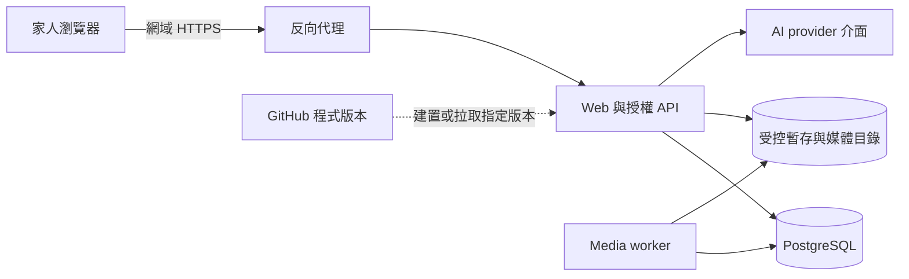

# 拾日系統與資料設計

版本：2026-10-18。以下是建議實作契約，尚未建立 schema、API 或應用程式。第一版單一家庭、單一 NAS，不引入多租戶或社群好友體系；需要擴展時另做決策紀錄。

## 技術與部署組成

| 層級 | 基準選擇 | 理由與限制 |
| --- | --- | --- |
| UI 與 Web API | Next.js、React、TypeScript | 同一專案處理 UI 與應用邊界；實作前查驗版本相容與安全更新 |
| 介面樣式 | Vanilla CSS 或專案既有 CSS，Lucide React | 延續溫馨版型，避免無必要的大型 UI 套件 |
| 資料存取 | Prisma＋PostgreSQL | 關聯、交易、migration；必要約束可用受控 SQL migration |
| 驗證 | ID＋密碼＋資料庫可撤銷 session | 不綁 email；驗證套件選型先確認能滿足重設、撤銷及本機初始化 |
| 媒體 | NAS 檔案目錄＋獨立 worker | 原檔與衍生檔持久化；Web request 不等待長片轉碼 |
| 處理工具 | FFmpeg／ffprobe 與必要圖片處理工具 | 能力以部署映像實測；套件／編碼授權在選型時確認 |
| 工作佇列 | PostgreSQL 持久化工作表 | 先控制複雜度，具備租約、重試、取消及原子領取 |
| AI | 可替換 provider 介面 | 未指定供應商；本機／外部由設定決定，未設定即停用 |
| 營運 | Docker Compose＋NAS 反向代理 | 明確版本、持久化與備份；GitHub 僅存程式 |

不預設導入雲端 Supabase、Redis、Kubernetes、Zeabur、外部物件儲存或自動公開部署。使用者技術偏好不代表本專案已授權改用雲端。若已有程式碼，先沿用並說明差異。

AI 箭頭只有使用者明確操作且已設定 provider 時才啟用。瀏覽器不直接連資料庫、模型服務或 NAS 路徑。

## 模組與檔案規劃

建議目錄為 app/、components/、lib/auth/、lib/policy/、lib/db/、lib/posts/、lib/media/、lib/ai/、workers/media/、prisma/、tests/、scripts/ 與 docs/。UI、輸入驗證、業務規則、授權及資料存取分清責任；伺服器機密模組不能被 client component 引入。

具體 auth 套件、富文字編輯器、驗證函式庫、測試工具及圖片庫在建立 package.json 前做短版選型紀錄，列必要功能、維護狀態、授權、版本相容性與新增用途。不在文件中指定未查證的最新版本。

## 帳號與 session

帳號 ID 3–32 字，只允許 ASCII 英數、底線、點、連字號；trim 後轉小寫得到唯一 usernameNormalized，顯示名稱獨立。密碼建議 15–128 字、允許片語，不 trim、不截斷。登入、建立、變更、臨時密碼均須定義一致的 Unicode 長度規則與輸入 byte 上限。

正式使用 Argon2id 密碼雜湊，獨立 salt 與可升級參數；以 NAS 實測和當時官方安全建議核定成本。不能使用一般 SHA256 或可逆加密代替密碼雜湊；隨機高熵 session token 則可只保存其雜湊。

Session token 放 Secure、HttpOnly Cookie，採適當 SameSite 與 CSRF／Origin 檢查。建議初始閒置到期 24 小時、絕對到期 7 天，屬待實測的設定預設，不是使用者已指定時限。所有寫入方法驗證 CSRF；GET 不改狀態。登出撤銷目前 session；改密碼、管理員重設或停用撤銷全部 session，重新登入取得新 token。僅信任受控代理標頭。

臨時密碼是一次性憑證：建立／重設原子寫入雜湊、期限、mustChangePassword 並撤銷舊 session；臨時登入只可改密碼或登出。建議期限 24 小時，可配置。密碼更新在交易內確認仍是有效重設版本，避免兩個並行請求重用。管理員不得查看既有密碼；本機 bootstrap／recovery 命令不得把明碼寫到 shell history、參數或日誌，採互動輸入或明確受控機制。

不存在與錯誤帳號使用一致訊息及近似驗證成本，配合按來源／帳號限速、有限延遲、稽核與避免永久鎖死。實際限速值依家庭網路、反向代理及 NAS 測量制定。最後管理員保護須交易內鎖定或等效序列化，防止同時停用兩位管理員後無人管理。

## 權限契約

| 操作 | 作者 | 可見共享貼文的家人 | 其他成員／管理員 | 未登入 |
| --- | --- | --- | --- | --- |
| 讀貼文／媒體 | 可以 | 可以 | 不可；管理角色不繞過 | 不可 |
| 改貼文／受眾／刪除 | 可以 | 不可 | 不可 | 不可 |
| 留言／心情 | 共享貼文可以 | 可以 | 不可 | 不可 |
| 刪留言 | 可管理自己貼文下留言 | 僅自己的留言 | 不可 | 不可 |
| 建立／停用帳號 | 依管理角色 | 依管理角色 | 管理角色可以 | 不可 |
| 執行 AI | 作者對自己的編輯內容 | 不可代作者編輯 | 不可 | 不可 |
| 匯出個人內容 | 自己內容 | 僅可下載已授權媒體 | 不可批量匯出他人私人內容 | 不可 |

建議以集中 canReadPost、canEditPost、canInteractPost 政策統一處理，實際查詢仍要在 DB 篩選，不能先取所有資料再由前端隱藏。所有頁面、API、搜尋、縮圖、Range、匯出與工作結果皆使用相同權限來源。無權限資源可一致回 404，避免識別資源存在；未登入的受保護 API 回 401。

互動寫入與受眾變更在同一貼文列上鎖或採等效序列化，在交易中重新檢查當下權限。僅在交易外檢查再寫入會有撤權競態。快取不能跨使用者共用私人回應；媒體首版由授權 API 讀取，撤權後新請求禁止，不能撤回已送出的內容。

## 資料表設計草案

ID 使用穩定 opaque ID，時間點採 UTC timestamptz，紀錄日期採 date。除明列外皆包含 createdAt、updatedAt；外鍵與刪除策略須寫進 migration，不依賴前端維護。

| 模型 | 主要欄位 | 約束與關聯 |
| --- | --- | --- |
| User | id, username, usernameNormalized, displayName, passwordHash, role, status, mustChangePassword, temporaryPasswordExpiresAt, passwordVersion, passwordChangedAt | usernameNormalized UNIQUE；role admin/member；status active/disabled；停用不刪文章 |
| Session | id, userId, tokenHash, issuedAt, lastSeenAt, expiresAt, absoluteExpiresAt, revokedAt, passwordVersion, restricted | tokenHash UNIQUE；user FK；檢查帳號狀態與密碼版本 |
| Post | id, authorId, recordDate, titleDoc, subtitleDoc, bodyDoc, plainText, visibility, status, version, publishedAt, deletedAt | visibility private/family/selected；status draft/published；author FK；版本條件更新 |
| PostDraft | id, authorId, postId 可空, draftDoc, audienceDraft, baseVersion, version | 草稿只限作者；已發布文的草稿不修改公開版本；同篇同作者唯一 |
| PostRevision | id, postId, version, contentSnapshot, actorId, reason | UNIQUE(postId,version)；只限作者讀；不得用舊受眾擴張現行權限 |
| PostAudience | postId, userId | 複合 PK；selected 才有效；交易維護並檢查有效成員 |
| Comment | id, postId, authorId, bodyText, createdAt, deletedAt | post/author FK；長度上限；軟刪除；依 postId,createdAt,id 分頁 |
| PostReaction | postId, userId, type, createdAt, updatedAt | 複合 PK；type 限九種；不可用新增多筆實作切換 |
| MediaAsset | id, ownerId, intendedPostId 可空, storageKey, originalName, mime, size, checksum, state, metadata, deletedAt | intendedPostId 僅暫定上傳目標；正式關聯由 PostMedia 決定；storageKey UNIQUE；未關聯資產僅 owner 可讀 |
| MediaVariant | id, assetId, purpose, storageKey, mime, width, height, duration, profileVersion | UNIQUE(assetId,purpose,profileVersion)；縮圖與影片版本分開 |
| PostMedia | postId, assetId, position, caption | 一個資產首版僅屬一篇貼文；assetId UNIQUE；排序更新在交易內 |
| UploadSession | id, ownerId, targetPostId 可空, expectedSize, chunkSize, state, expiresAt, finalizedAssetId | 綁定 owner；finalize 可重試且只產生一個 asset |
| UploadChunk | uploadId, chunkIndex, size, checksum, storageKey | 複合 PK；同 index 異內容回衝突，禁止覆寫已確認分段 |
| MediaJob | id, assetId, kind, profileVersion, state, attempts, availableAt, leaseOwner, leaseUntil, leaseVersion, lastErrorCode | UNIQUE(assetId,kind,profileVersion)；租約 fencing 防止過期 worker 提交 |
| IdempotencyRecord | userId, operation, key, requestHash, resultRef, expiresAt | 複合唯一；相同 key 異內容回 409，不保存敏感原始請求 |
| MemoryPreference | userId, postId 可空, localDate 可空, action | 隱藏特定貼文或日期；定義 CHECK 保證目標合法 |
| Tag／PostTag | id, ownerId, nameNormalized；postId,tagId | 標籤查詢仍須套貼文權限，不從標籤數洩露私人內容 |
| Album／AlbumItem | id, ownerId, title；albumId,assetId,position | 整理容器不授予超過原貼文的媒體權限 |
| Notification | id, recipientId, actorId, postId, commentId 可空, kind, readAt | 首版可延後；開啟時重驗權限，預設不寄信、不含私人全文 |
| ExportJob | id, ownerId, scope, state, storageKey, expiresAt | 工作與下載都授權；成品非公開目錄，期限到清除 |
| AuditEvent | id, actorId 可空, action, resourceType, resourceId, outcome, requestId, createdAt | 不保存密碼、token、AI 私文、完整 request body |

PostMedia 是正式貼文與媒體關聯的唯一來源；MediaAsset.intendedPostId 只提供暫定上傳目標，不能單憑該欄授權其他家人。發布時在交易中驗證 owner、目標、可用狀態與 PostMedia 關聯。

PostDraft、IdempotencyRecord、UploadChunk 等為本次開發設計補充，支持已確認的草稿／續傳／重試需求。通知、相簿及匯出可在後續階段建立，不為未交付功能先增加大量表。若使用共享媒體去重，另做引用與授權設計，不能讓不同貼文共用一個權限含糊的公開 URL。

建議索引涵蓋作者／紀錄日期／id、已發布未刪貼文排序、PostAudience.userId、留言順序、有效 session、可領取工作 availableAt/leaseUntil。歷年今日可用 month/day 欄位或 expression index，依查詢測量決定；不假設一般 B-tree date 索引就能加速所有月份函式查詢。中文搜尋先採有限資料量可驗證方案，再評估 PostgreSQL 擴充與斷詞，不宣稱預設全文搜尋已解決中文需求。

## 富文字與內容版本

正式內容採帶 schemaVersion 的結構化 JSON，不保存任意可執行 HTML。允許 paragraph、text、hardBreak 與受控 marks：bold、italic、underline、colorToken；後續節點明確升版。伺服器限制深度、節點數、總長、連結協定與 mark 值；渲染只允許已知節點，貼上的 HTML 也需清理。

plainText 是由驗證後文件產生的搜尋衍生資料，不作為唯一原文。發布／更新在同一交易保存 Post、Revision、Audience、媒體關聯；更新帶 expectedVersion，不一致回 409 並保留草稿。編輯發布文使用獨立 PostDraft，避免 autosave 提前向家人曝光。

正式畫面的貼文發布時間採 publishedAt；createdAt 表示資料列建立時間，可能早於發布。留言顯示 createdAt。兩者皆由伺服器產生，不使用使用者回填紀錄日期或瀏覽器時鐘冒充發布時間。既有預覽只有 createdAt，不能把這項簡化直接帶入正式草稿流程。

## API 契約草案

路徑為建議，可依實際框架調整，但授權與行為不可省略。成功包含資料與下一頁 cursor；錯誤格式建議 `{ error: { code, message, requestId, fieldErrors? } }`。400 輸入錯、401 未登入、403 有權知悉但禁止操作、404 不存在或不可見、409 版本／冪等衝突、413 太大、415 不支援、429 限速、503 依賴未就緒。不得回傳原始 SQL 或堆疊。

| 方法與路徑 | 行為與主要限制 |
| --- | --- |
| POST /api/auth/login | username/password；驗證後設 Cookie，不在 JSON 回 token |
| POST /api/auth/logout | 撤銷 session；CSRF 保護 |
| GET /api/me | 自身顯示資料與角色，不包含 hash 或 token |
| POST /api/me/password | 現密碼／臨時憑證驗證＋新密碼；交易更新並撤銷 session |
| POST /api/me/logout-all | 近期重新驗證後撤銷全部 session |
| GET /api/family/members | 已登入取得最少顯示資訊，用於選受眾；不包含管理敏感欄位 |
| GET, POST /api/admin/users | 管理員清單／建立；不提供匿名註冊 |
| PATCH /api/admin/users/:id | 顯示名稱／角色／狀態；最後管理員與自身操作保護 |
| POST /api/admin/users/:id/reset-password | 近期管理員重新驗證；產生一次性憑證、撤銷 session、稽核 |
| GET /api/posts?view=personal\|family&cursor=... | DB 層授權、固定排序、回憶標記、穩定去重 cursor |
| POST /api/posts | 發布已驗證內容；作者／時間由伺服器決定；冪等鍵 |
| GET, PATCH, DELETE /api/posts/:id | 讀取／expectedVersion 更新／軟刪除；逐項授權 |
| GET, POST /api/drafts | 作者自己的草稿清單／建立草稿；綁定既有貼文時檢查作者權限 |
| GET, PUT, DELETE /api/drafts/:id | 作者專用；版本衝突處理，不改已發布文；丟棄不刪原文 |
| GET /api/posts/:id/revisions | 作者可讀；恢復另建新版，不倒退版本號 |
| POST /api/posts/:id/restore-revision | expectedVersion＋來源 revisionId；重新驗證權限與媒體 |
| GET, POST /api/posts/:id/comments | 游標分頁／冪等新增；當下可見權限 |
| DELETE /api/comments/:id | 留言作者或貼文作者；不因知道 comment ID 就可刪 |
| PUT, DELETE /api/posts/:id/reaction | 設定指定 type／取消；同人唯一；PUT 採期望結果而非 toggle |
| POST /api/uploads | 驗證大小、配額、目標貼文權限；建立工作 |
| PUT /api/uploads/:id/chunks/:index | owner 驗證、大小與 checksum；禁止超配額／任意路徑 |
| GET /api/uploads/:id | 僅 owner 得知已接收分段與狀態 |
| POST /api/uploads/:id/finalize | 完整性核對、一次性生成 asset/job，重試回相同結果 |
| DELETE /api/uploads/:id | 取消與排程清理，不任意同步遞迴刪路徑 |
| GET /api/media/:id/content?variant=... | 驗證當下貼文權限、固定 variant 白名單、Range 支援 |
| GET /api/search?q=... | DB 授權後搜尋，不能從摘要或總數洩露私文 |
| PUT /api/me/memory-preferences | 自己的隱藏偏好；不改原貼文 |
| POST /api/ai/suggestions | 任務、自己的 draft/post、來源版本、明確操作；provider 未設定回明確狀態 |
| POST /api/exports | 僅自身內容範圍；背景作業與授權下載 |

進階相簿、通知、備份管理 UI 的 API 在該階段補完整契約，不以此列表聲稱涵蓋所有 FB 功能。所有端點的敏感回應禁止公共快取。UUID 不能取代授權。

## 上傳與工作交易

上傳工作綁定 owner、預期大小、分段大小、期限與目標；在確認空間／配額後接收。每段由伺服器產生路徑，驗證 index／長度／checksum。完成時核對總大小及雜湊，辨識真實媒體，不只信任 Content-Type 或副檔名。

檔案系統與 DB 不能共享同一交易：採暫存→校驗→同磁碟原子 rename→DB 狀態提交，並設 reconciler 清理孤兒檔與恢復中斷狀態。已確認原檔不因轉碼失敗刪除。具體狀態至少 uploading/verifying/queued/processing/ready/archive_only/failed/cancelled；資產與工作的狀態分開，重試不倒退已驗證原檔。

Worker 使用交易與 SKIP LOCKED 或等效原子領取，取得 leaseVersion，定期心跳；輸出提交確認租約仍有效。過期 worker 不得覆寫新 worker 結果。重試採有限次數與退避，唯一工作鍵與暫存輸出避免重複處理；取消後不可再發布成品。首版併發 1，CPU／RAM／時間與磁碟配額依 NAS 設定。

FFmpeg 以參數陣列呼叫、不組 shell 字串，不接受使用者指定遠端來源、任意 filter 或輸出路徑。限制容器權限、掛載範圍與網路；不將媒體 worker 掛載 Docker socket。原檔、縮圖、分段都必須受控讀取；Range 的每次請求重新授權。

## AI 服務邊界

介面建議 `suggest({ task, content, sourceVersion, locale, tone, signal })` 回傳帶 schema 的 proposals 與 sourceVersion；provider 設定只在伺服器。task 白名單為 suggest_titles、polish、summarize、structure、suggest_tags。不提供任意抓取 NAS 或讀取其他貼文的工具。

AI 內容是建議，不是可執行命令。先預覽後採用；套用前比較 sourceVersion，採用建立新 revision，可回復。取消、逾時、限額、格式錯誤保留原文；沒有供應商時仍可完成一般寫作。單獨的 mock provider 只供測試，正式環境不得回固定範例冒充推論。

## 待選擇與風險

需在實作時核定 auth 套件、富文字庫、確切版本、媒體處理庫、搜尋方案、session/密碼重設期限、刪除保留期。NAS CPU 架構、RAM、可用空間、AI provider 尚未知，不能承諾轉碼吞吐或本機模型效能。上述未決不阻止先建立本機 app、PostgreSQL、帳號、貼文與授權測試。
